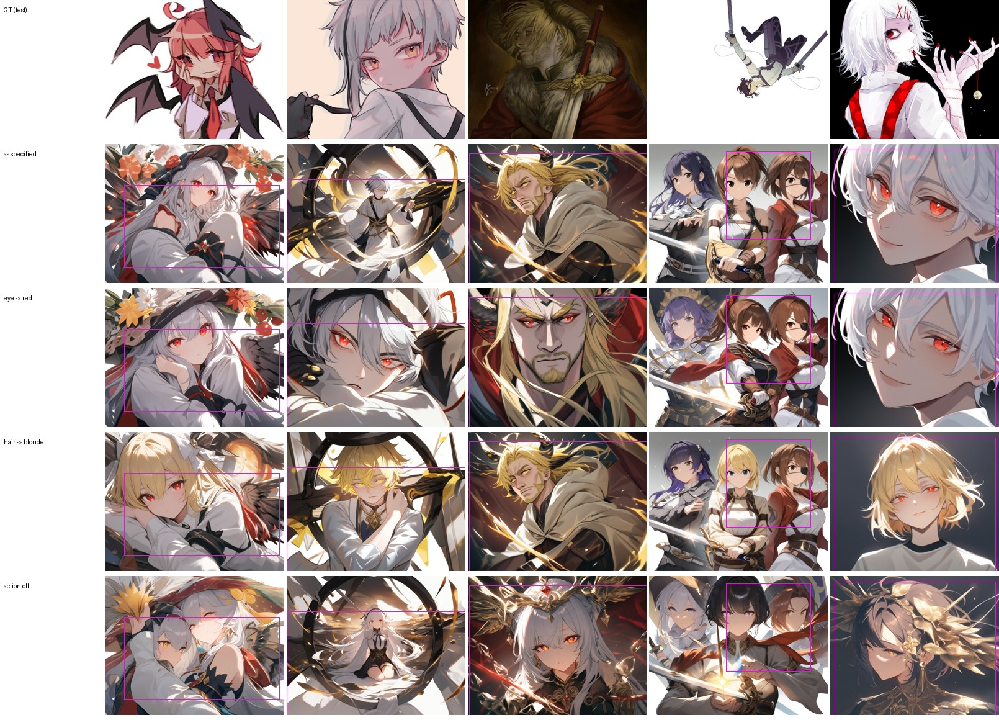
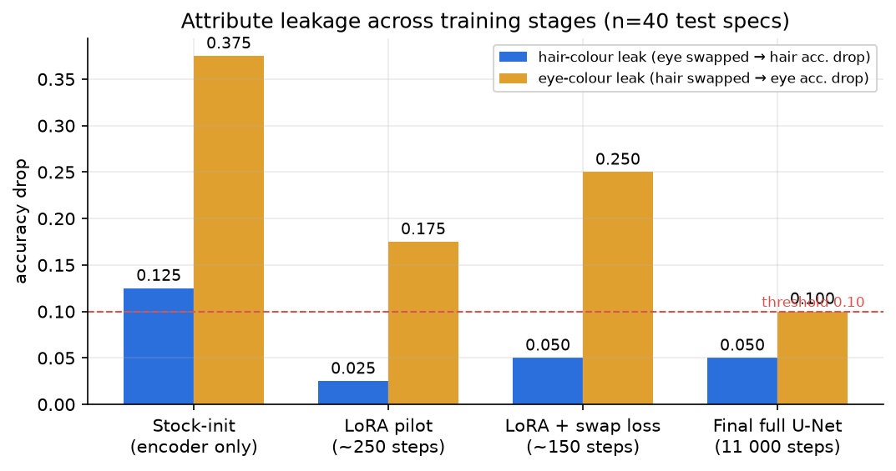

# LAM-Diffusion

**Controllable anime character generation with a Large Action Model planner and a latent diffusion backbone.**

This repo builds the trained version of the method in *"LAM-Diffusion: Generative Image Synthesis of Anime
Characters Using Large Action Models and Diffusion Techniques"* (R. S. Yadunand Raj, Divya Udayan J). It covers
the paper's §IV architecture, its five training stages and its Algorithm 1. It also includes the dataset the
paper notes is missing, a fully trained model, and a web app.

Instead of reading a prompt as one blob of text, a **planner** turns the request into a **structured action
descriptor**: each character's gender, age, pose, ordered actions, hair, eyes, outfit, expression and position.
The descriptor drives a diffusion U-Net through a **dual-stream conditioning pathway**, so attributes stay
attached to the right character.


<sub>Trained model on held-out test specs. Rows: ground truth · as specified · only eye colour → red · only hair colour → blonde · action stream off.</sub>

---

## Highlights

- **The full §IV architecture, end to end:**
  - LAM Encoder (pose encoding, action-dynamics encoding, style-attribute fusion);
  - dual-stream conditioning (cross-attention in every U-Net layer + a temporal attention module);
  - an anime-optimised VAE;
  - the Eq. 3 four-term loss;
  - all five training stages of §IV-F;
  - Algorithm 1 (image → actions → image).
- **A fully trained model.** Animagine XL 4.0 with **every U-Net weight trained** (not LoRA) jointly with the LAM Encoder, 11,000 steps on an H200.
- **A new dataset: 28,145 anime action-pose-text triplets.** 50,677 characters with 18-point skeletons, boxes, ordered actions and per-character attributes, from a balanced Danbooru selection. Plus 11,254 ordered action sequences from HumanML3D captions for pre-training.
- **Measured, including where it falls short.** Colour leakage drops from 0.125 / 0.375 (hair / eye) to **0.05 / 0.10**. Descriptor → image retrieval reaches **R@1 83%**, and the temporal module orders sub-actions at **77%** (chance 50%). But absolute **hair-colour accuracy is below stock Animagine** (64.8% vs 100%) on an 8×8 colour test; see [Results](docs/RESULTS.md#colour-factorial-vs-stock-animagine).
- **LAM Studio, a web app** (Next.js + FastAPI) to describe a scene, edit the planned layout and poses, and generate next to a prompt-only baseline.

## How it works


```
prompt ──► Planner F_LAM ──► action descriptor A ──► LAM Encoder ──► dual-stream conditioning
          (Qwen2.5 LLM /       characters, boxes,      action tokens        │
           rules)              poses, attributes                            ▼
                                     Gaussian noise ──► U-Net (trained) ──► VAE decoder ──► image
```

Each character's attribute tokens join the U-Net's text tokens in **one shared attention**, masked to that
character's bounding box. Outside every box, the U-Net behaves exactly like the pre-trained model.


More: [Architecture](docs/ARCHITECTURE.md) · [Paper → code](docs/IMPLEMENTATION.md).

## Results

| Stage | Metric | Before | After |
|---|---|---|---|
| 1 · anime VAE decoder | PSNR / LPIPS (held-out anime crops) | 31.51 dB / 0.0638 | **32.35 dB / 0.0575** |
| 2a · action-text pre-training | sub-action order accuracy | 49.5% | **77.2%** |
| 2 · LAM on anime triplets | descriptor → image R@1 / R@10 (999 test) | 4.9% / 18.6% | **83.0% / 97.6%** |
| Algorithm 1 head `G_θ` | presence / gender / box L1 | — | 90.9% / 70.3% / 0.088 |
| 3–5 · full U-Net, 11k steps | hair / eye colour leakage (lower is better) | 0.125 / 0.375 | **0.05 / 0.10** |
| 3–5 · full U-Net, 11k steps | hair / eye colour correct, 8×8 factorial (stock Animagine → ours) | 100% / 48.4% | 64.8% / 56.2% |



Full results, the diagnosis history (including what failed) and known limitations are in [docs/RESULTS.md](docs/RESULTS.md).
The paper's §V-C metric suite (CLIP Score, FID, LPIPS, SSIM, binding precision) is implemented in `lam/eval/`.

## The app

| | |
|---|---|
|  | **Describe** → the planner writes an editable spec · **Layout & pose** → drag the character boxes · **Generate** → image plus a prompt-only baseline on the same seed. Screen recording: [`output/lam_studio_app_demo.mp4`](output/lam_studio_app_demo.mp4). |

## Quick start

**Use the trained model** (weights on Kaggle: [`lam-diffusion-final`](https://www.kaggle.com/datasets/shibilahamed0095/lam-diffusion-final)):

```bash
git clone https://github.com/ShibilAhamed701212/lam-diffusion && cd lam-diffusion
pip install -r requirements.txt
```

```python
from lam.model import LAMDiffusion
from lam.pipeline import LAMDiffusionPipeline

model = LAMDiffusion(gradient_checkpointing=False, unet_mode="full", unet_path="unet/")   # unet.safetensors + config.json
model.load_trainable("weights.pt", strict=False)
pipe = LAMDiffusionPipeline(model)
image = pipe([descriptor], width=1216, height=832, steps=24, cfg=5.0, seed=0)[0]
```

Full example with a descriptor, fp16 on T4, Algorithm 1, the app server and Kaggle: [docs/INFERENCE.md](docs/INFERENCE.md).

**Run the app:**

```bash
LAM_SESSION=myapp scripts/colab_up.sh            # GPU server on Colab + tunnel (writes web/.env.local)
npm --prefix web install && npm --prefix web run dev
```

**Train from scratch:** [docs/TRAINING.md](docs/TRAINING.md). Build the dataset, then stage 1 → 2a → 2 → 3–5.

## Data and weights

| | Where |
|---|---|
| Trained U-Net + LAM weights + pose library | Kaggle: [`shibilahamed0095/lam-diffusion-final`](https://www.kaggle.com/datasets/shibilahamed0095/lam-diffusion-final) |
| Anime descriptors (28,145 triplets, split, pose library, stats; **no images**) | Kaggle: [`shibilahamed0095/lam-diffusion-descriptors`](https://www.kaggle.com/datasets/shibilahamed0095/lam-diffusion-descriptors) |
| Algorithm 1 head `G_θ`, stage 1 anime VAE, stage 2a / 2 encoder checkpoints, stage logs | Kaggle: [`shibilahamed0095/lam-diffusion-extras`](https://www.kaggle.com/datasets/shibilahamed0095/lam-diffusion-extras) |
| Precomputed training set (latents, half-size ground truth, CLIP features, index) | Kaggle: [`shibilahamed0095/lam-diffusion-precomputed`](https://www.kaggle.com/datasets/shibilahamed0095/lam-diffusion-precomputed) |
| Dataset recipe and format | [docs/DATASET.md](docs/DATASET.md) |

## Repository layout

```
lam/          model (§IV): descriptor, encoder, conditioning, model, pipeline, losses, inverse,
              training stages, planner, data build, eval, tests, jobs
server/       FastAPI inference API: planner, spec, poses, engines (trained LAM / ControlNet prototype)
web/          Next.js app (LAM Studio)
scripts/      Colab helpers: VM setup, background jobs, keep-alive, big uploads, Drive mount, sample batch
report/       figure scripts, figures and logged stage results
reports/      diagnosis sheets and sample grids from every milestone
output/       app demo video and sample generations
docs/         architecture · implementation · dataset · training · inference · results
```

## Documentation

| Doc | Contents |
|---|---|
| [ARCHITECTURE.md](docs/ARCHITECTURE.md) | The four blocks, tensor shapes, conditioning maths, loss |
| [IMPLEMENTATION.md](docs/IMPLEMENTATION.md) | Paper → code map, interpretation choices, additions and deviations, design history |
| [DATASET.md](docs/DATASET.md) | How the triplet dataset and the action-text corpus are built, with statistics and format |
| [TRAINING.md](docs/TRAINING.md) | Every stage with commands, settings and results; orchestration on cloud GPUs |
| [INFERENCE.md](docs/INFERENCE.md) | Python API, Algorithm 1, the app and server, Kaggle |
| [RESULTS.md](docs/RESULTS.md) | All metrics, qualitative sheets, failures and limitations |

## Acknowledgements

- The method is from the LAM-Diffusion paper by R. S. Yadunand Raj and Divya Udayan J (Amrita Vishwa Vidyapeetham). The paper itself is not included in this repo.
- Base models: [Animagine XL 4.0](https://huggingface.co/cagliostrolab/animagine-xl-4.0), [SDXL VAE fp16-fix](https://huggingface.co/madebyollin/sdxl-vae-fp16-fix), [TAESDXL](https://huggingface.co/madebyollin/taesdxl), [CLIP ViT-L/14](https://huggingface.co/openai/clip-vit-large-patch14), [Qwen2.5-3B-Instruct](https://huggingface.co/Qwen/Qwen2.5-3B-Instruct). Each is used under its own license.
- Data: [danbooru2024-sfw](https://huggingface.co/datasets/deepghs/danbooru2024-sfw) (artworks belong to their artists; images are not redistributed), [HumanML3D](https://github.com/EricGuo5513/HumanML3D) captions, the WD EVA02 tagger and RTMPose / HumanArt for annotation.
- Sample sheets under `reports/` include small ground-truth thumbnails from the dataset for comparison; those artworks belong to their artists.
