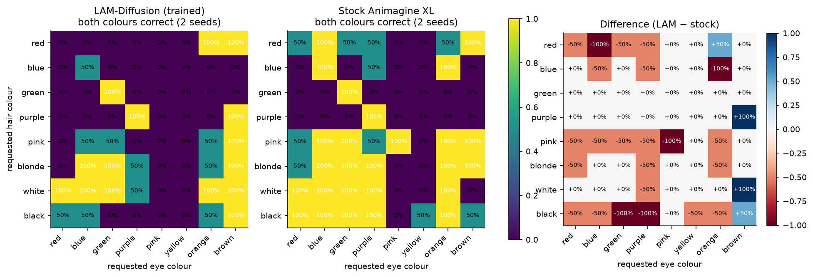
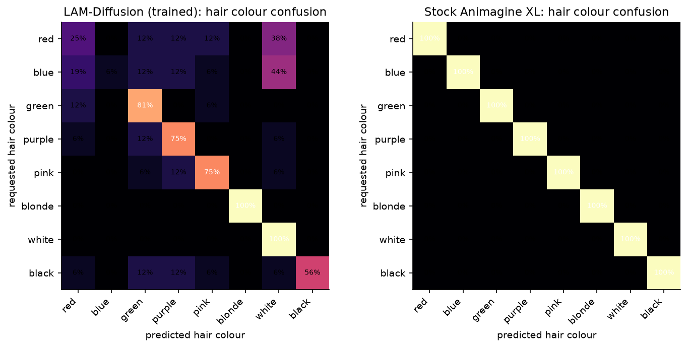
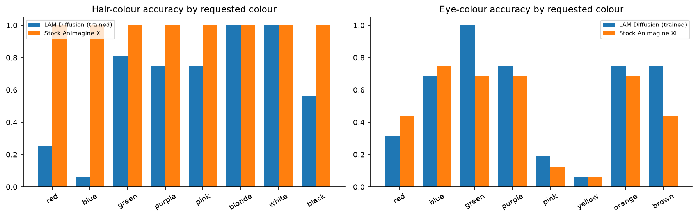
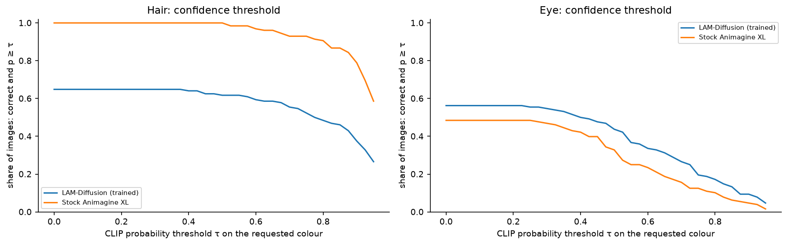
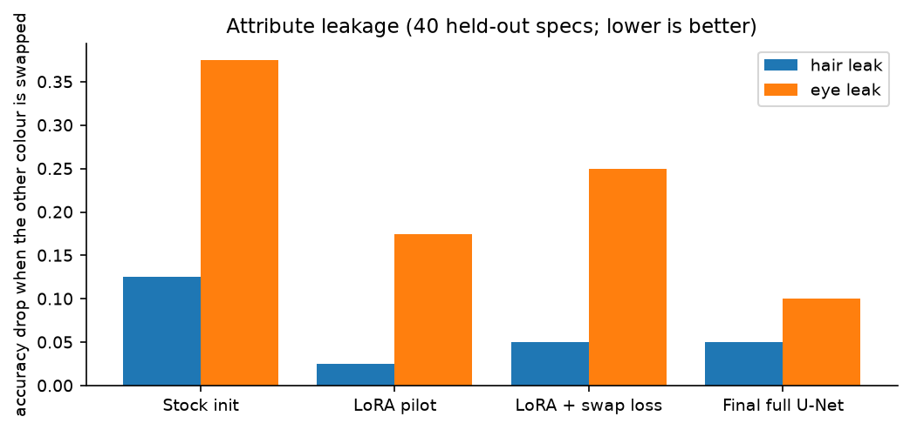

# Results analysis: hypotheses, heat maps, thresholds, comparisons, gaps

Every figure and table here is produced by `python reports/scripts/make_analysis.py` from the logged data in
`reports/data/`. Figures and CSV tables are in [`reports/analysis/`](../reports/analysis).

**Main test set (colour factorial):** a single character on a plain background, **8 hair colours × 8 eye colours ×
2 seeds = 128 images per system**. It's rendered by the trained LAM-Diffusion model (from the structured
descriptor) and by stock Animagine XL (prompt only, same seed). A CLIP ViT-L/14 zero-shot classifier reads the hair
and eye colour of each image and returns a probability for each of the 8 colours.

---

## 1. Hypotheses and verdicts

| # | Hypothesis (from the paper's claims) | Test | Evidence | Verdict |
|---|---|---|---|---|
| H1 | Action-level planning gives better attribute binding than prompt-only diffusion (§I, §V-D) | Colour factorial, both colours correct | LAM **31.2%** vs stock **48.4%** | ❌ **Not supported** for colour attributes |
| H2 | Separating attributes per character (dual-stream, box masks) reduces attribute leakage | Swap one colour, measure the other's accuracy drop (40 specs) | hair leak 0.125 → **0.05**, eye leak 0.375 → **0.10** | ✅ Supported, within the model |
| H3 | Action-text pre-training teaches action order (temporal module, §IV-C) | True vs shuffled order on HumanML3D test | 49.5% (chance) → **77.2%** | ✅ Supported |
| H4 | Fine-tuning the LAM on triplets aligns descriptors with images (§IV-F stage 2) | Descriptor → image retrieval, 999 test | R@1 4.9% → **83.0%**, median rank 137 → 1 | ✅ Supported |
| H5 | An anime-optimised VAE reconstructs anime better (§IV-D) | Held-out anime crops | PSNR 31.51 → **32.35 dB**, LPIPS 0.0638 → **0.0575** | ✅ Supported (small gain) |
| H6 | The image → action head recovers the descriptor (Algorithm 1) | Held-out latents | gender **70.3%** vs 53.8% majority; framing **60.1%** vs 53.2% majority | 🟡 Partially: above majority, far from reliable |
| H7 | Full-U-Net training keeps the base model's colour vocabulary | Hair accuracy vs stock | **64.8%** vs **100%**; red and blue collapse to white | ❌ **Rejected**: catastrophic narrowing |
| H8 | The descriptor helps multi-character layout and binding | Kaggle side-by-side (6 scenes) | wins the classroom pair (stock draws 3 people); loses 4 of 6 overall | 🟡 Inconclusive: qualitative, n = 6 |

The model learns what each training stage optimises (H2–H5), but in this test the end-to-end generation **doesn't
beat its base on colour binding** (H1, H7).

---

## 2. Heat maps

### Joint accuracy: requested hair × requested eye

- **Stock Animagine** gets every hair colour right. It fails mostly on **eye colour**: yellow (0% in almost every row) and pink.
- **LAM-Diffusion** fails whole **rows**: red hair and blue hair are almost never right.
- **Hair–eye coupling:** for green and purple hair, LAM is right only when the eyes are the *same* colour (green+green, purple+purple). The model tends to apply one colour to both, which is a leakage pattern the swap test doesn't fully capture.
- LAM beats stock in a few cells, mainly **brown** and **orange** eyes (purple/brown, white/brown: +100%).

### Hair-colour confusion: what was asked vs what CLIP sees

Stock is a clean diagonal. LAM sends **red → white 38%** and **blue → white 44%**, with smaller spills into green,
purple and pink. Blonde and white are perfect, and black is 56%. This is a **collapse toward white/silver hair**,
a common anime look that is likely over-represented in the training descriptors.

Eye-colour confusion (both systems weak, with LAM pulled toward brown):
[`a3_confusion_eye.png`](../reports/analysis/a3_confusion_eye.png).

---

## 3. Per-colour patterns

| Hair colour | LAM | Stock | | Eye colour | LAM | Stock |
|---|---|---|---|---|---|---|
| red | 25% | 100% | | red | 31% | 44% |
| blue | 6% | 100% | | blue | 69% | 75% |
| green | 81% | 100% | | green | 100% | 69% |
| purple | 75% | 100% | | purple | 75% | 69% |
| pink | 75% | 100% | | pink | 19% | 12% |
| blonde | 100% | 100% | | yellow | 6% | 6% |
| white | 100% | 100% | | orange | 75% | 69% |
| black | 56% | 100% | | brown | 75% | 44% |

(CSV: [`t2_per_colour.csv`](../reports/analysis/t2_per_colour.csv))

- **Hair:** LAM is strong on blonde and white (100%), weaker on green, purple and pink (75–81%), and fails on red (25%), blue (6%) and black (56%).
- **Eyes:** LAM is better overall (56.2% vs 48.4%), driven by green (100% vs 69%) and brown (75% vs 44%), but it's worse on red and blue eyes. Both systems fail on yellow (6%) and pink (12–19%).

## 4. Confidence thresholds and colour maps

Share of images where the requested colour is predicted **and** CLIP's probability for it is at least τ:

| Field | System | τ = 0.3 | τ = 0.5 | τ = 0.7 | τ = 0.9 |
|---|---|---|---|---|---|
| hair | LAM-Diffusion | 0.648 | 0.617 | 0.555 | 0.375 |
| hair | Stock Animagine | **1.000** | **1.000** | **0.930** | **0.789** |
| eye | LAM-Diffusion | **0.547** | **0.438** | **0.266** | **0.094** |
| eye | Stock Animagine | 0.469 | 0.328 | 0.156 | 0.047 |

LAM's eye-colour advantage holds at every threshold, and roughly doubles at strict thresholds (0.094 vs 0.047 at
τ = 0.9). Stock's hair advantage is large everywhere. Mean probability on the requested colour: hair 0.593 (LAM)
vs 0.921 (stock); eye 0.434 (LAM) vs 0.348 (stock).

Distribution of those probabilities: [`a6_confidence_hist.png`](../reports/analysis/a6_confidence_hist.png).

## 5. Leakage across training

| Run | hair leak | eye leak |
|---|---|---|
| Stock initialisation (encoder only) | 0.125 | 0.375 |
| LoRA pilot (~250 steps) | 0.025 | 0.175 |
| LoRA + swap-consistency loss (~150 steps) | 0.05 | 0.25 |
| Final full U-Net (11,000 steps) | 0.05 | 0.10 |

---

## 6. Comparison tables

### LAM-Diffusion vs stock Animagine (colour factorial)

| Metric | LAM-Diffusion | Stock Animagine | Better |
|---|---|---|---|
| Hair colour correct | 64.8% | **100%** | stock |
| Eye colour correct | **56.2%** | 48.4% | LAM |
| Both correct | 31.2% | **48.4%** | stock |
| Mean CLIP prob., requested hair | 0.593 | **0.921** | stock |
| Mean CLIP prob., requested eye | **0.434** | 0.348 | LAM |

### This work vs the paper's reported numbers

| | Paper (§V) | This work |
|---|---|---|
| System | Rule-based planner + stock Stable Diffusion, inference only, CPU | Learned planner + trained LAM Encoder + fully trained U-Net (§IV) |
| Training | None | 5 stages, 11,000-step full run |
| CLIP Score / FID / LPIPS / SSIM / binding | 0.87 / 18.4 / 0.32 / 0.91 / 0.94 | Not run yet with the paper's protocol. Not comparable. |
| Attribute binding | 0.94 (object placement) | Colour factorial both-correct 31.2%; leakage 0.05 / 0.10 |

### Stage results

Full table: [`t5_stage_results.csv`](../reports/analysis/t5_stage_results.csv).

---

## 7. Where there is room to improve

Ranked by expected impact, each tied to the evidence above.

| # | Gap (evidence) | Likely cause | What to try |
|---|---|---|---|
| 1 | **Hair-colour collapse to white** (H7; red 25%, blue 6%) | White/silver hair over-represented in the descriptors; full-U-Net training narrowed the base model's colour vocabulary | Rebalance colour frequencies or oversample rare colours; lower U-Net LR or LoRA / partial unfreezing; mix in prompt-only base samples (prior preservation) |
| 2 | **Hair–eye coupling** (green/purple right only on matching eyes) | Field tokens of one character share a box mask, so the eye tokens can tint the hair | Separate sub-region masks (head vs eyes), or a per-field token-type embedding in attention; add the colour factorial as a training-time validation |
| 3 | **Eye colours yellow and pink** (both systems 6–19%) | Rare and small in images; CLIP may also misread them | More eye-close-up data; check against a face-crop classifier instead of whole-image CLIP |
| 4 | **Character count and pose following** (Kaggle: extra or missing characters) | Cross-attention-only pose control (the paper's design) is weak | Add the paper's suggested ControlNet-style spatial conditioning (§VI-B) from the descriptor's keypoints |
| 5 | **Algorithm 1 head** (gender 70%, framing 60%) | Small ConvNet on latents, noisy labels | Use CLIP image features alongside the latent; train longer; clean labels |
| 6 | **Evaluation coverage** | Only colour and leakage are measured at scale | Run the full §V-C suite (`lam/eval/`): CLIP score, FID/KID, LPIPS, SSIM, binding precision, pose PCK, with ablations |
| 7 | **Planner** | Fine-tuned planner LoRA not in the released weights; app falls back to the base LLM / rules | Release and evaluate the planner fine-tune |

### Caveats on these numbers
- n = 128 images per system (2 seeds per cell). A single cell is 0%, 50% or 100%.
- The CLIP zero-shot colour reader is itself imperfect, especially on stylised hair and small eyes.
- The prompts are single characters on a plain background. Multi-character binding isn't measured quantitatively yet.
