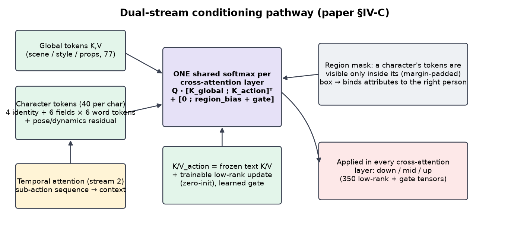

# Architecture

LAM-Diffusion puts a **planner** between the user's sentence and the image model. The planner turns the
sentence into a **structured action descriptor**: who is in the scene, their gender and age, what each character
is doing, where they stand, and their hair, eyes, outfit and expression. A **LAM Encoder** embeds that
descriptor, a **dual-stream conditioning pathway** injects it into every cross-attention layer of a
latent-diffusion **U-Net**, and a **VAE** decodes the result.

```
A = F_LAM(N)        Eq. 1   prompt N  ->  action descriptors A = {a_1 ... a_n}
I = G_diff(A)       Eq. 2   the image is generated from A, not from the raw prompt
```


The model has the four blocks of the paper's Fig. 1. Section numbers (§) refer to the paper.

---

## Block 0: Planner `F_LAM` (Eq. 1)

| | |
|---|---|
| Code | `server/planner.py` (app), `lam/planner_ft.py` + `lam/planner_data.py` (learned planner), `lam/spec_bridge.py`, `lam/pose_library.py` |
| Input | Free text, e.g. *"a boy with black hair and a girl with pink twintails sitting side by side in a classroom"* |
| Output | A JSON **spec**: global `scene / style / props / aspect` + up to 3 characters with `gender, age, pose, framing, hair_color, hair_style, eye_color, outfit, expression, extra, position` |

Two planners share one output shape:
- **LLM planner**: Qwen2.5-3B-Instruct. It emits the spec as JSON, and a LoRA fine-tune (`planner_ft.py`) on (request → descriptor) pairs teaches it gender, age and pose from data instead of keyword rules.
- **Rule planner** (`rule_plan`): keyword matching, close to the paper's "rule-assisted NLP planner" (§V-A). It's the fallback and an ablation.

`server/spec.py: normalize_spec` makes every spec well-formed (defaults, clamping, layout boxes).
`lam/spec_bridge.py` turns a spec into the model's **action descriptor**: fields map one-to-one, and keypoints
come from the **data-mined pose library** (`pose_library.py`, k-means centres of real skeletons per action),
placed inside each character's box. No prompt-tag string is built.

### The action descriptor (`lam/descriptor.py`)

Per character (max 3):

| Field | Type |
|---|---|
| `gender`, `age`, `framing`, `view` | categorical ids → learned embeddings |
| `actions` | up to 4 **ordered** sub-actions from a 78-label vocabulary (posture → limb action → interaction) |
| `keypoints` | 18 OpenPose keypoints `(x, y, confidence)`, normalized to the image |
| `bbox` | normalized `x0, y0, x1, y1` |
| `hair_color`, `hair_style`, `eye_color`, `outfit`, `expression`, `extra` | free text, encoded **separately** |

Plus a global `scene / style / props`. During training, `collate` applies CFG dropout (drop everything) and
per-field dropout, so partially specified descriptors still work.

---

## Block 1: LAM Encoder (§IV-B), `lam/encoder.py`

Descriptor → action embeddings `B × N × D_action`, with `D_action = 2048` (SDXL's cross-attention width).

**Pre-trained transformer backbone.** SDXL's two CLIP text transformers (CLIP-L + OpenCLIP-bigG, penultimate
layers, the "GPT/BERT-paradigm" transformer of §IV-B), LoRA-tuned. Each free-text field is encoded on its own.

**Action Semantic Embedding.** The three parts named in the paper:

| Part | Implementation |
|---|---|
| Pose encoding | `PoseEncoder`: transformer over 18 keypoint tokens (Fourier coordinates + joint-id embeddings) + a bbox token → Perceiver pooling → pose tokens |
| Action dynamics encoding | `DynamicsEncoder`: learned sub-action embeddings (initialised from the backbone's encoding of the label names) + kinematic features from the skeleton (limb angles, body extent, arm height, leg spread) + step embeddings → one token per sub-action |
| Style attribute fusion | `StyleAttributeFusion`: identity + pose + dynamics + attribute tokens → 2-layer fusion transformer → Perceiver resampler → residual added to every character token (zero-initialised) |

**Output** (`LAMOutput`):
- `global_hidden` `[B, 77, 2048]`: the global descriptor, encoded exactly like SDXL text, so the U-Net's native path keeps working.
- `char_tokens` `[B, 3, 40, 2048]` and `char_token_mask`: per character, **4 identity tokens** (gender, age, framing, view) + **6 fields × 6 word tokens** of the backbone's own token sequence for each attribute, plus the fused pose/dynamics/temporal residual. Unspecified age or framing tokens are masked.
- `pooled` `[B, 1280]`: SDXL's added text embedding (from the global descriptor).
- `action_embed` `[B, 768]`: in CLIP image space, used by `L_action-img`.

Why full token sequences and not one averaged vector per field: averaging shrank the tokens to about a third
of the scale the U-Net expects, and colours never bound. With the real word tokens, "blonde hair" is readable
from step 0. See [IMPLEMENTATION.md § design history](IMPLEMENTATION.md#design-history-the-v3-conditioning).

---

## Block 2: Dual-Stream Conditioning Pathway (§IV-C), `lam/conditioning.py`



**Stream 1, cross-attention conditioning.** In **every** cross-attention layer of the U-Net (down, mid and up,
at all resolutions: the paper's "multi-resolution cross-attention with action embeddings"), the character tokens
join the global tokens in **one shared softmax**:

```
out = softmax( Q [K_global ; K_action]^T / sqrt(d) + [0 ; region_bias + g] ) [V_global ; V_action]
```

- `K/V_action` = the layer's frozen text K/V weights + a trainable rank-64 update (zero-initialised), so action tokens start out read like text tokens.
- `region_bias`: each character's tokens are visible only from latent positions inside its bounding box (with a 4% margin). This is the layout prior of the paper's Fig. 3, and it binds attributes to the right person. Outside every box, the layer is exactly the pre-trained one.
- `g`: a learned per-layer logit bias on the action tokens, starting at 0 (our addition, logged as the "gate").

**Stream 2, Temporal Attention Module.** `TemporalAttention` runs self-attention over each character's
**ordered** sub-action tokens ("running, then jumping, then landing"). Its context vector is fused into that
character's tokens before injection, through a tanh gate that starts at 0. Stage 2a supervises it with real
ordered action sequences (see [TRAINING.md](TRAINING.md#stage-2a-action-text-pre-training)).

---

## Block 3: Latent Diffusion Backbone (§IV-D), `lam/model.py`, `lam/pipeline.py`

| Component | Implementation |
|---|---|
| VAE encoder | SDXL VAE (fp16-fix), **frozen**: latents never move |
| VAE decoder | **anime-optimised** in stage 1 (decoder-only fine-tune), frozen afterwards |
| Denoising U-Net | **Animagine XL 4.0** (anime-tuned SDXL, ε-prediction). In the paper-faithful run **every U-Net weight is trained** (`--unet-mode full`); a LoRA mode exists as a cheaper fallback |
| Sampler | Euler-ancestral, about 20–28 steps |
| CFG | classifier-free guidance against the dropped-conditioning embedding (no characters, empty or negative global text), scale about 5 |

`LAMDiffusionPipeline` implements the §IV-F inference pipeline (descriptor → encoder → Gaussian latent →
T conditioned denoising steps → VAE decode), plus:
- `algorithm1()`: the paper's Algorithm 1 / Eq. 4–6 (image → `h = F_φ(x)` → `a = G_θ(h)` → diffusion with the Eq. 5 update → decode). See [IMPLEMENTATION.md](IMPLEMENTATION.md#interpretation-choices).
- `prompt_only()`: the stock-Animagine baseline on the same weights.
- Optional attention-map capture, for interpretability.

---

## Block 4: Loss computation (§IV-E, Eq. 3), `lam/losses.py`

```
L_total = λ1·L_diff + λ2·L_action-img + λ3·L_perc + λ4·L_style
```

| Term | Implementation | λ (final run) |
|---|---|---|
| `L_diff` | ε-prediction MSE, the plain "standard denoising loss" (min-SNR weighting available but **off** in the faithful run) | 1.0 |
| `L_action-img` | cosine + InfoNCE (512-entry queue) between the LAM action embedding and the CLIP ViT-L/14 embedding of the generated image | 0.005 |
| `L_perc` | LPIPS (VGG) between the generated and ground-truth image | 0.02 |
| `L_style` | Gram-matrix MSE on VGG-16 relu1_2…relu4_3 features | 200 (Gram MSE ≈ 1e-5) |

The three auxiliary terms need an image. They use the one-step estimate `x̂0` from the predicted noise, decoded
by **TAESDXL** (a tiny differentiable decoder), and are applied only at low noise (`t < 400`). The λs were cut
10× after pilots showed swirly, muddy textures at the original weights (see [RESULTS.md](RESULTS.md#pilots-and-the-swirl-fix)).

---

## Training stages (§IV-F)


| # | Paper stage | Script |
|---|---|---|
| 1 | Pre-train the anime VAE | `lam/train_vae.py` |
| 2a | Pre-train the LAM on an action-text corpus | `lam/train_stage2a.py` |
| 2 | Fine-tune the LAM on anime action-pose-text triplets | `lam/train_stage2.py` |
| 3 | Train the U-Net (frozen VAE) with joint LAM fine-tuning, Eq. 3 | `lam/train_joint.py --unet-mode full` |
| 4 | Progressive curriculum: basic poses → multi-action → fine style | `CurriculumSampler` in `lam/dataset.py` |
| 5 | CFG training by dropping the action conditioning | `collate(..., train=True)` in `lam/descriptor.py` |
| – | Algorithm 1 head `G_θ` | `lam/train_inverse.py` |

Details, commands and per-stage results: [TRAINING.md](TRAINING.md).
