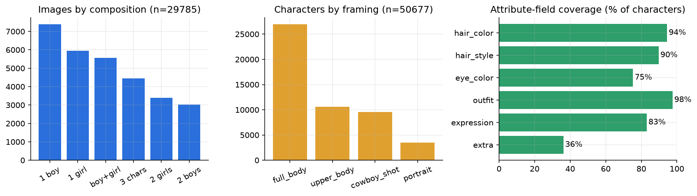
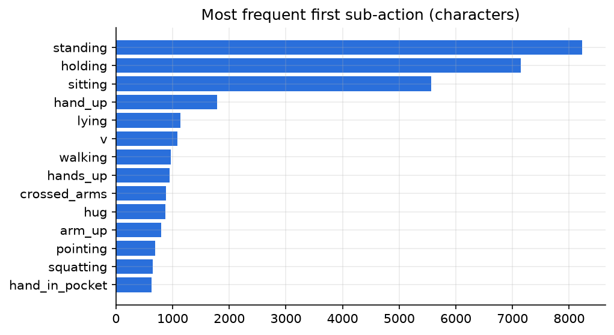

# Datasets

The paper calls for an **action-text corpus** for pre-training and an **anime action-pose-text triplet dataset**
for fine-tuning (§IV-B, §IV-F), but publishes neither (§III-B mentions the "scarcity of annotated datasets").
This repo builds both.



## 1. Anime action-pose-text triplets: 28,145 samples

**Source:** [`deepghs/danbooru2024-sfw`](https://huggingface.co/datasets/deepghs/danbooru2024-sfw), Danbooru posts
with NSFW removed. Only images the tagger rates **general** are kept. Images are used for training only; they are
**not redistributed**. The published dataset contains annotations and Danbooru post IDs, never pixels.

Built in four resumable stages (`lam/data/`):

| Stage | Script | What it does |
|---|---|---|
| 1. Select | `select.py` | Picks a **balanced** set from tag metadata. Danbooru is heavily skewed to "solo young girl standing", which made boys and old men come out as girls. Fixed composition shares: solo-female 30%, solo-male 25%, female+male 15%, female+female 10%, male+male 8%, trio 12%. Elderly ×25 and adults ×3 are boosted, and postures are flattened with inverse-√frequency weights. Result: **29,785** post IDs. |
| 2. Fetch | `fetch.py` | Downloads only the selected images, using HTTP **range requests** into the 7.5 GB tar shards (each shard has a JSON index of byte offsets), so whole shards are never pulled. Resumable. |
| 3. Annotate | `annotate.py` | Builds the descriptor (Eq. 1's A) per image. **Poses:** RTMPose-x + a YOLOX detector trained on HumanArt (illustrations, including anime): 18 OpenPose keypoints per person. **Characters:** the *n* largest valid skeletons (n from the people-count tags), ordered left to right. **Attributes:** solo images use the human-written Danbooru tags; multi-character images run the **WD EVA02-large tagger on each person's crop**, so hair, eyes and outfit bind to the right character. **Global:** scene, style and props from the image tags. `tag_vocab.py` maps tags to fields. |
| 4. Precompute | `precompute.py` | Per sample, once: SDXL-VAE latents at one of 7 aspect buckets (1024², 1152×896, 896×1152, 1216×832, 832×1216, 1344×768, 768×1344); a half-size ground-truth JPEG (for `L_perc` / `L_style`); the CLIP ViT-L/14 image embedding (for stage 2 and `L_action-img`); SDXL `time_ids`. Keypoints and boxes are re-expressed in the cropped frame. A size filter (every character ≥ 20% of frame height, the largest ≥ 35%) keeps **28,145**. The split is stratified by composition: **27,146 train / 999 test**. |

`report.py` renders a stats sheet and a grid of annotated triplets for visual QA (`reports/m1/samples.jpg`).

### Statistics (annotated set)

| | |
|---|---|
| Images / characters | 29,785 / 50,677 |
| Composition | solo-male 7,394 · solo-female 5,952 · female+male 5,561 · trio 4,453 · female+female 3,391 · male+male 3,034 |
| Gender | female 27,258 · male 23,419 |
| Age | unspecified 46,155 · child 3,051 · elderly 743 · adult 728 |
| Framing | full body 26,975 · upper body 10,617 · cowboy shot 9,570 · portrait 3,515 |
| With at least one action | 82.7% of characters |
| Field coverage | outfit 97.5% · hair colour 94.4% · hair style 89.7% · expression 83.0% · eye colour 75.3% · extra 36.2% |



### Record format

`annotations.jsonl` has one line per image; `index.jsonl` is the same plus `split`, `bucket`, `file`, `time_ids`
and keypoints remapped to the bucket crop. Abridged example (geometry values illustrative):

```json
{
  "id": 7414129, "split": "train", "bucket": [1216, 832], "comp": "duo_mf",
  "global": {"scene": "couch, simple background, white background", "style": "", "props": []},
  "characters": [
    {"gender": "female", "age": "unspecified", "framing": "full_body", "view": "front",
     "actions": ["sitting"], "bbox": [0.31, 0.05, 0.53, 0.95],
     "keypoints": [[0.42, 0.12, 0.93], "... 18 x (x, y, conf)"],
     "hair_color": "blonde", "hair_style": "ahoge, long hair", "eye_color": "",
     "outfit": "skirt, hair ornament, necktie, shirt, socks", "expression": "smile, closed eyes", "extra": ""},
    {"gender": "male", "...": "..."}
  ]
}
```

`pose_library.json` holds k-means centres of real skeletons per action, in a box-relative frame. It's what the
learned planner path uses to turn "running" into keypoints.

## 2. Action-text corpus: HumanML3D captions

`lam/data/humanml3d.py` downloads only the caption text (`texts.zip` and the split lists) from the public
[HumanML3D](https://github.com/EricGuo5513/HumanML3D) repo. The AMASS motion data isn't needed. Each caption is
split on sequence connectives ("then", "after that", commas, …) into **ordered sub-action phrases**, mapped onto
the same 78-label action vocabulary as the anime data. Like the Danbooru tag mapping, this is data annotation and
is never used at generation time.

| | |
|---|---|
| Training captions (including mirrored copies) | 69,896 |
| Captions mapped to at least one action | 75.8% |
| Ordered multi-step sequences (≥ 2 distinct sub-actions) | **11,254** |

Example: *"a person walks forward, then turns around and sits down"* → `walking → looking_back → sitting`.

## 3. Planner training pairs

`lam/planner_data.py` has Qwen write the natural-language request a user might type for real dataset descriptors.
The phrasing varies ("grandpa", "old man", "a guy"), and a fraction get character-level typos ("grandfater").
`lam/planner_ft.py` fine-tunes Qwen2.5-3B-Instruct + LoRA on these (request → descriptor) pairs.

## Where to get it

| What | Where |
|---|---|
| Descriptors, split, pose library, stats (no images) | Kaggle: [`shibilahamed0095/lam-diffusion-descriptors`](https://www.kaggle.com/datasets/shibilahamed0095/lam-diffusion-descriptors) |
| Rebuild from scratch | `python -m lam.data.select` → `fetch` → `annotate` → `precompute` (GPU for annotate/precompute) |
| Precomputed training set (5.7 GB tar: SDXL latents, half-size ground-truth JPEGs, CLIP embeddings, `index.jsonl`) | Kaggle: [`shibilahamed0095/lam-diffusion-precomputed`](https://www.kaggle.com/datasets/shibilahamed0095/lam-diffusion-precomputed). Extract to `/content/data` (or pass `--samples`). |

**Licensing:** the annotations are derived from Danbooru metadata and model predictions. The underlying artworks
belong to their respective artists. Use the descriptors for research, and fetch images from the original source
under its terms.
