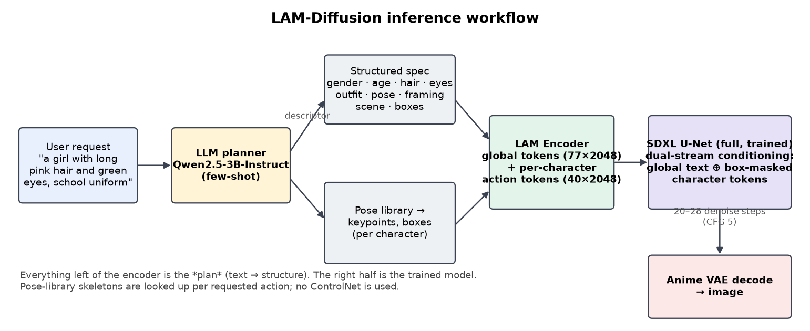
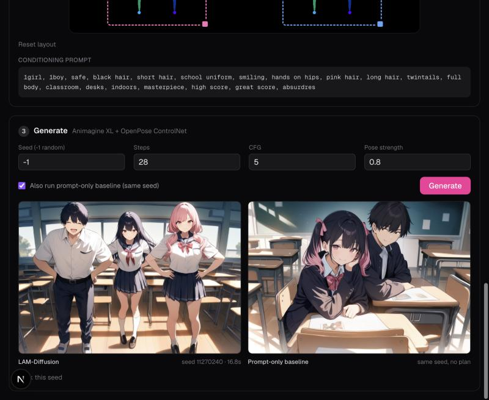

# Inference

There are three ways to run the trained model:
1. **Python API**: generate from a descriptor or a prompt in your own code.
2. **LAM Studio app**: the Next.js UI plus the FastAPI GPU server.
3. **Kaggle**: free T4 GPUs, with the trained weights attached as a dataset.



## Trained weights

| File | Size | What |
|---|---|---|
| `unet.safetensors` + `unet_config.json` | 5.1 GB (bf16) | The fully trained Animagine XL U-Net (11,000 steps) |
| `weights.pt` | 325 MB | Everything else that was trained: LAM Encoder, text-encoder LoRA, dual-stream processors, gates |
| `pose_library.json` | 0.3 MB | Data-mined skeletons per action (planner path) |
| `inverse.pt` | 138 MB | Algorithm 1 head `G_θ` (image latent → descriptor) |
| `vae_anime/` | 320 MB | Stage 1 anime VAE decoder (pass `vae_path=` to `LAMDiffusionPipeline`) |
| `stage2a.pt`, `stage2_from2a.pt` | 509 MB each | Encoder checkpoints after stage 2a and stage 2 (to reproduce or resume the stages) |

The first three are on Kaggle in [`shibilahamed0095/lam-diffusion-final`](https://www.kaggle.com/datasets/shibilahamed0095/lam-diffusion-final),
and `G_θ`, the anime VAE and the stage checkpoints are in [`shibilahamed0095/lam-diffusion-extras`](https://www.kaggle.com/datasets/shibilahamed0095/lam-diffusion-extras).
For a diffusers-style folder, put `unet_config.json` → `config.json` and `unet.safetensors` →
`diffusion_pytorch_model.safetensors` in one directory.

## 1. Python API

```python
import os
os.environ["LAM_DTYPE"] = "fp16"   # set before importing lam on GPUs without bf16 (T4); omit on A100/H100
from lam.model import LAMDiffusion
from lam.pipeline import LAMDiffusionPipeline

model = LAMDiffusion(gradient_checkpointing=False, unet_mode="full", unet_path="path/to/unet_folder")
model.load_trainable("path/to/weights.pt", strict=False)
model.half().eval().requires_grad_(False)          # fp16 inference weights: fit a 15 GB T4
pipe = LAMDiffusionPipeline(model)                  # pass vae_path=... to use the stage-1 anime decoder

descriptor = {
    "global": {"scene": "classroom, desks, indoors", "style": "masterpiece, high score", "props": []},
    "characters": [
        {"gender": "male", "age": "teen", "framing": "full_body", "view": "front", "actions": ["sitting"],
         "bbox": [0.05, 0.1, 0.48, 0.95], "hair_color": "black", "hair_style": "short hair",
         "eye_color": "brown", "outfit": "school uniform", "expression": "smile", "extra": ""},
        {"gender": "female", "age": "teen", "framing": "full_body", "view": "front", "actions": ["sitting"],
         "bbox": [0.52, 0.1, 0.95, 0.95], "hair_color": "pink", "hair_style": "twintails",
         "eye_color": "blue", "outfit": "school uniform", "expression": "smile", "extra": ""},
    ],
}
image = pipe([descriptor], width=1216, height=832, steps=24, cfg=5.0, seed=0,
             negative="nsfw, lowres, bad anatomy, worst quality, low quality")[0]
image.save("out.png")
```

Useful options of `pipe(...)`:
- `action_scale`: 0 turns the action stream off, which leaves the global descriptor only.
- `region_masking=False`: ablation without the box masks.
- `capture_attention=True`: stores per-layer attention maps on each processor's `last_map`.

**From a prompt:** turn text into a spec with `server/planner.py` (`LLMPlanner` or `rule_plan`), then into a
descriptor with `lam.spec_bridge.spec_to_descriptor(spec, pose_library)`. Keypoints come from the pose library.

**Algorithm 1** (reference image → predicted actions → new image):

```python
import torch
from PIL import Image
from lam.inverse import ActionFromLatent

ck = torch.load("inverse.pt", map_location="cpu")
g = ActionFromLatent(ck["vocab"]).cuda().eval(); g.load_state_dict(ck["model"])
images, predicted = pipe.algorithm1([Image.open("ref.png")], g, width=832, height=1216, eta=0.0)
```

`eta=0` generates a new image from the predicted descriptor; `eta → 1` pulls the result toward the reference.

## 2. LAM Studio app

```
browser ── Next.js (web/) ── /api/lam/* proxy ──► FastAPI (server/) on the GPU box
                    the tunnel URL and token stay on the server side
```

| Step in the UI | Endpoint | What happens |
|---|---|---|
| 1. Describe | `POST /plan` | LLM or rule planner → spec. A safety filter rejects NSFW requests. |
| 2. Layout & pose | `POST /render` | Spec → normalized spec + pose skeleton image. Boxes are draggable and the spec is editable. |
| 3. Generate | `POST /generate` | Spec → image, optionally with the prompt-only baseline on the same seed. |

Two engines (`LAM_ENGINE`):

| Engine | What it is |
|---|---|
| `lam` | **The trained LAM-Diffusion model (§IV).** Spec → descriptor → LAM Encoder → dual-stream conditioning → fully trained U-Net. |
| `controlnet` (default) | The early prototype in the style of the paper's §V: spec → hand-written tag prompt + OpenPose ControlNet on stock Animagine. It's kept as a baseline. |

Server environment variables:

| Variable | Meaning |
|---|---|
| `LAM_TOKEN` | Shared secret. Every request needs the `X-LAM-Token` header because the tunnel URL is public. |
| `LAM_ENGINE` | `lam` or `controlnet` |
| `LAM_UNET` | Folder of the fully trained U-Net (unset = base U-Net + LoRA from `LAM_WEIGHTS`) |
| `LAM_WEIGHTS` | `weights.pt` |
| `LAM_POSE_LIBRARY` | `pose_library.json` |
| `LAM_PLANNER` | `llm` or `rules` |
| `LAM_PLANNER_LORA` | Fine-tuned planner LoRA folder (optional; without it the app falls back to the base LLM or rules) |
| `LAM_DTYPE` | `fp16` for T4-class GPUs (no bf16) |
| `LAM_BASELINE_DEVICE` | Device for the stock-Animagine baseline in full mode (e.g. `cuda:1`) |

**Run on Colab** (ControlNet engine; starts the server, a Cloudflare tunnel and writes `web/.env.local`):

```bash
LAM_SESSION=myapp LAM_GPU=L4 scripts/colab_up.sh
npm --prefix web install && npm --prefix web run dev      # http://localhost:3000
```

**Run anywhere with a GPU** (trained model):

```bash
pip install -r server/requirements.txt
export LAM_ENGINE=lam LAM_UNET=/path/unet LAM_WEIGHTS=/path/weights.pt \
       LAM_POSE_LIBRARY=/path/pose_library.json LAM_TOKEN=$(openssl rand -hex 24)
cd server && uvicorn app:app --host 0.0.0.0 --port 8000
# point the web app at it: web/.env.local  ->  LAM_API_URL=http://<host>:8000  LAM_TOKEN=<same token>
```



A screen recording of the app is in [`output/lam_studio_app_demo.mp4`](../output/lam_studio_app_demo.mp4)
(ControlNet engine). Sample generations are in [`output/samples/`](../output/samples).

## 3. Kaggle

Attach [`lam-diffusion-final`](https://www.kaggle.com/datasets/shibilahamed0095/lam-diffusion-final) to a GPU
notebook (T4 ×2, internet on). The notebook [`lam-diffusion-inference`](https://www.kaggle.com/code/shibilahamed0095/lam-diffusion-inference)
clones this repo, loads the trained model in fp16 and renders sample descriptors.

## Sampling defaults

Euler-ancestral, 20–28 steps, CFG 5. Quality tags `masterpiece, high score, great score, absurdres` are appended
to the global style. The negative prompt is the evaluation's standard one (low quality, bad anatomy, …, plus
`nsfw`).
