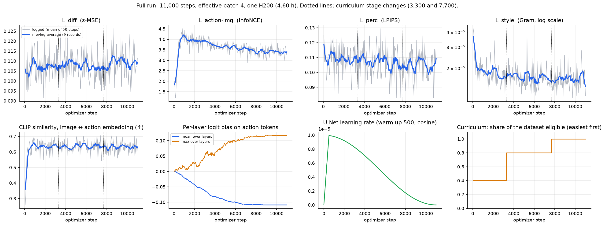
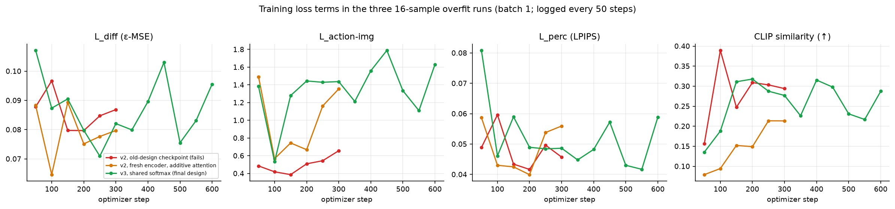
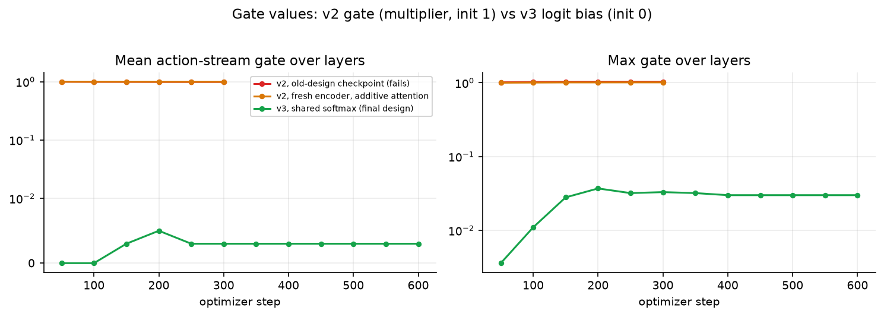
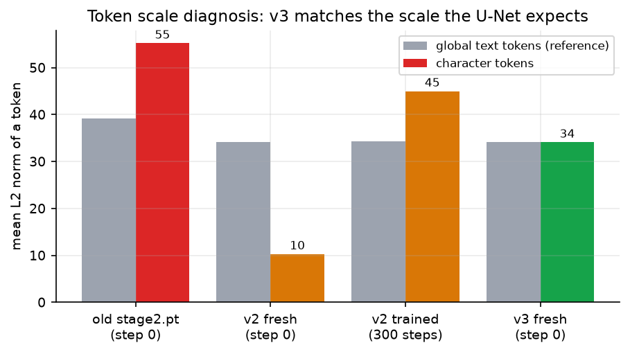

# Research-paper data pack

Everything a write-up of this project needs in one place: what data exists and where, the figures and tables ready
to use, the exact settings, the statistics, and an honest list of what **isn't** available. All numbers come from
logged runs in this repo. Nothing here is estimated or filled in.

## 0. Data availability: read this first

| Data | Status | Where / why |
|---|---|---|
| Stage results (VAE, action-text, triplet retrieval, `G_θ`) | ✅ available | `reports/data/stage*.json`, `inverse.json` |
| Colour factorial raw scores (256 images) | ✅ available | `reports/data/colour_factorial.json` |
| Leakage probes (stock, pilots, final) | ✅ available | `reports/data/leakage_*.json` |
| Dataset statistics | ✅ available | `reports/data/dataset_stats.json` |
| Loss curves of the three **16-sample overfit runs** (the design history) | ✅ available | `reports/data/training_logs_recovered.csv` |
| Loss / gate values of short pilots and the full-U-Net overfit gate | ✅ available (few points) | same CSV |
| **Loss curve of the 11,000-step full run** | ✅ **available** (pulled from the Lightning studio) | `reports/data/full_run_phaseB.csv` (220 records, one per 50 steps), raw log `reports/data/logs/full_run_phaseB.log` |
| Sample grids across the full run (15 checkpoints) | ✅ available | `reports/milestones/full_run_samples/` |
| Launch scripts / evaluation log of the full run | ✅ available | `reports/data/logs/` |
| **Gradient norms of any completed run** | ❌ **never logged** | Confirmed: the full-run log has no gradient-norm field. The script printed loss terms and gates only. Logging was added afterwards (`metrics.jsonl`, `gnorm`), so future runs will have it. Can't be reconstructed. |
| Trend tests, per-stage statistics, timing of the full run | ✅ computed | [TRAINING_ANALYSIS.md](TRAINING_ANALYSIS.md), `reports/analysis/training_*.csv` |
| Learning-rate curve | ✅ derivable | Deterministic: 500-step linear warm-up, then cosine to 0 (formula in the code) |
| Throughput / time of the full run | ✅ measured | 4.60 h wall-clock for 11,000 steps = 1.51 s/step (from the log). The A100 numbers (1.87 s/step, 23.2 GB peak at batch 1) were measured by `lam/tests/smoke_full.py`. |
| §V-C metrics (CLIP score, FID/KID, LPIPS, SSIM, binding, PCK) on the final model | ❌ not run | Code exists in `lam/eval/`; needs a GPU run |
| Quantitative ablations (no region masks, no temporal stream, diffusion-only loss) | ❌ not run | Only qualitative step-0 comparisons exist |
| Multi-character binding measured quantitatively | ❌ not run | The colour factorial uses one character |
| Variance across training seeds / repeated runs | ❌ not available | One full run only |
| Human evaluation | ❌ not run | — |

## 1. Figures ready for the paper

All in `reports/figures/`, regenerated by `reports/scripts/make_figs_1.py`, `make_diagrams.py` and
`make_paper_figs.py`.

### Architecture and method (flow charts, one per component)

| File | Shows | Suggested use |
|---|---|---|
| `d4_system_architecture.png` | End-to-end system: prompt → planner → descriptor → LAM → conditioning → U-Net → VAE, with the training loss | Fig. 1 |
| `d5_planner.png` | Planner `F_LAM` (Eq. 1): safety filter, LLM / rule planner, normalisation, pose library | Method: planner |
| `d6_lam_encoder.png` | LAM Encoder internals: backbone, pose, dynamics, temporal, fusion, token layout | Method: encoder |
| `d3_dualstream.png` | Dual-stream pathway overview | Method: conditioning |
| `d7_attention_layer.png` | One cross-attention layer: shared softmax, region bias, K/V | Method: conditioning detail |
| `d8_loss.png` | Eq. 3 computation: x̂0 → decoder → four loss terms | Method: loss |
| `d9_algorithm1.png` | Algorithm 1 (Eq. 4–6) | Method: Algorithm 1 |
| `d10_data_pipeline.png` | Dataset construction | Data section |
| `d1_inference.png`, `d2_training.png` | Inference pipeline; training stages | Method overview |

### Data and training

| File | Shows |
|---|---|
| `f1_dataset.png`, `f2_actions.png` | Composition, framing, field coverage; most frequent first actions |
| `f3_stage1.png` | Stage 1: PSNR / LPIPS vs step |
| `f4_stage2a.png` | Stage 2a: caption retrieval and order accuracy |
| `f5_stage2.png` | Stage 2: retrieval vs step |
| `f6_inverse.png` | `G_θ` per-epoch metrics |
| `f8_throughput.png` | Throughput: A100 (measured at batch 1, ×4) vs H200 full run (measured from the log) |
| `p4_full_run_curves.png` | **Full 11,000-step run:** all loss terms, gate bias, learning-rate schedule, curriculum |
| `p1_loss_terms_overfit.png` | L_diff, L_action-img, L_perc and CLIP similarity in the three overfit runs |
| `p2_gate_values.png` | Gate / bias values: multiplier gate (v2) vs logit bias (v3) |
| `p3_token_norms.png` | Character-token vs text-token norms across the designs |

### Results

| File | Shows |
|---|---|
| `p7_full_run_progression.png` | The same 8 specs rendered at steps 750 / 3,000 / 6,000 / 9,000 / 11,000 |
| `p8_throughput_over_run.png` | Seconds per step across the full run |
| `p5_scorecard.png` | One-page scorecard: all stage metrics, leakage and colour factorial |
| `p6_confidence_intervals.png` | Colour factorial with 95% bootstrap CIs |
| `f7_leakage_progress.png` | Leakage across training runs |
| `kaggle_lam_vs_stock.png` | Qualitative: trained model vs stock Animagine, 6 scenes |
| `reports/analysis/a1…a7` | Heat maps, confusion matrices, per-colour accuracy, thresholds, confidence histograms ([ANALYSIS.md](ANALYSIS.md)) |

Qualitative sheets are in `reports/milestones/` (`final/final_diag.jpg` for held-out specs, `m3_diag/` for the
design diagnosis, `gate_full/` for the full-U-Net gate).

## 2. Tables

LaTeX tables: [`reports/analysis/tables.tex`](../reports/analysis/tables.tex). CSV: `reports/analysis/*.csv`.

### Colour factorial with uncertainty (n = 128 paired images; 95% bootstrap CI, 10,000 resamples)

| Metric | LAM-Diffusion | Stock Animagine XL | Difference (LAM − stock) | Discordant pairs (LAM-only / stock-only) | Exact McNemar p |
|---|---|---|---|---|---|
| Hair correct | 64.8% [56.2, 72.7] | 100% [100, 100]* | **−35.2 pp** [−43.0, −27.3] | 0 / 45 | < 0.0001 |
| Eye correct | 56.2% [47.7, 64.8] | 48.4% [39.8, 57.0] | +7.8 pp [−0.8, +16.4] | 21 / 11 | **0.11** |
| Both correct | 31.2% [23.4, 39.1] | 48.4% [39.8, 57.0] | **−17.2 pp** [−25.8, −9.4] | 6 / 28 | 0.0002 |

\* Every image was correct, so the bootstrap interval has zero width.

**Reading:** the hair-colour deficit and the both-colours deficit are statistically clear. The eye-colour
**advantage is not significant** (the interval includes 0, p = 0.11), so it shouldn't be claimed as an improvement.

### Stage results

| Stage | Metric | Before | After |
|---|---|---|---|
| 1 anime VAE | PSNR (dB) / LPIPS, held-out crops | 31.51 / 0.0638 | 32.35 / 0.0575 |
| 2a action-text | sub-action order accuracy (2,000 test sequences) | 0.495 | 0.772 |
| 2a action-text | caption R@1 (1,000 motions) | 0.060 | 0.123 |
| 2 triplets | descriptor → image R@1 / R@10 (999 test) | 0.049 / 0.186 | 0.830 / 0.976 |
| Algorithm 1 `G_θ` | gender / framing accuracy vs majority class | 0.538 / 0.532 | 0.703 / 0.601 |
| Full U-Net | hair / eye leakage, 40 specs | 0.125 / 0.375 | 0.05 / 0.10 |

## 3. Loss functions, gradients and related metrics

**Total loss (Eq. 3):** `L = λ1·L_diff + λ2·L_action-img + λ3·L_perc + λ4·L_style`

| Term | Definition | λ (final run) |
|---|---|---|
| `L_diff` | mean squared error between predicted and true noise (plain, min-SNR off) | 1 |
| `L_action-img` | InfoNCE, temperature 0.07, 512-entry queue, between the CLIP image embedding of x̂0 and the LAM action embedding | 0.005 |
| `L_perc` | LPIPS (VGG) between decoded x̂0 and the ground-truth image | 0.02 |
| `L_style` | MSE of Gram matrices of VGG-16 relu1_2…relu4_3 features | 200 |

The three auxiliary terms use the one-step clean estimate x̂0 decoded by TAESDXL, only for noise level t < 400.
Gradients are clipped to a global norm of 1.0, and the pre-clip norm is now written to `metrics.jsonl` (new runs
only).

### Full 11,000-step run

Values from `reports/data/full_run_phaseB.csv` (mean over each 50-step logging window; averages of the first and
last 20 records):

| Term | First 20 records | Last 20 records | Min | Max |
|---|---|---|---|---|
| `L_diff` | 0.1071 | 0.1083 | 0.0915 | 0.1263 |
| `L_action-img` | 3.344 | 3.381 | 1.205 | 4.515 |
| `L_perc` | 0.1114 | 0.1024 | 0.0829 | 0.1295 |
| `L_style` | 2.27e-5 | 1.70e-5 | 1.13e-5 | 4.29e-5 |
| CLIP similarity (↑) | 0.589 | 0.631 | 0.259 | 0.706 |
| Gate bias mean / max | 0.000 / 0.001 | −0.109 / +0.117 | | |

**What the curves show, stated plainly:**
- **`L_diff` is flat** (about 0.107 → 0.108) over the whole run. The noise-prediction loss did not improve. No NaN appeared (the cuDNN fix held).
- **`L_perc` and `L_style` decrease** (−8% and −25% between the first and last 20 records; most of the `L_style` drop happens in the first ~500 steps).
- **CLIP similarity rises quickly** (0.26 → ~0.63 in the first ~600 steps) and then stays flat.
- **`L_action-img` rises first** (1.9 → ~4.2 in the first ~800 steps) **then drifts down** to ~3.4. While the similarity to the positive pair goes up, this InfoNCE value goes up as well. A plausible reading is that the queue of negatives (512 recent action embeddings) becomes as image-like as the positive. This explanation was **not tested**.
- **The action-token bias settles by ~8,000 steps** (it follows the learning-rate decay) at a mean of −0.109 and a max of +0.117, so the learned bias on the action tokens stays small.

**What this does not show:** the average loss going flat doesn't by itself mean nothing was learned: the stage
metrics and the leakage test above are where the training effect appears. But there's no loss-based evidence of
improvement in `L_diff`, and the colour test (§ 2) shows the end result is not better than the base model on colour.

### What the logged loss curves of the overfit runs do and don't show

These are 16-sample overfit runs at batch size 1, logged every 50 steps, so they're **noisy**, and they show
something worth stating plainly: **the loss terms alone did not separate the failing design from the working one.**
The v3 run's `L_action-img` is not lower than the failing v2 run's, and `L_diff` fluctuates around 0.08 in all three.
The designs were told apart by the rendered samples and by token-scale diagnostics, not by the loss values.

The one quantity that *did* separate them is the character-token scale (values measured by
`lam/tests/diag_step0.py`): old checkpoint 55.2 (max 166) vs text 39.1; v2 fresh 10.3 vs 34.2; v2 after training
45.0 vs 34.3; **v3 34.1 vs 34.2**.

### Loss weights: how they were chosen

At λ = (0.05, 0.1, 2000) every sample grid turned into swirly texture by step 200. Diffusion-only and 10×
lower auxiliary weights stayed clean, so (0.005, 0.02, 200) was used (`reports/milestones/pilot/`). The logs of
those pilots record the loss values but not which weights each session used, so a controlled weight-sweep table
can't be built from them.

## 4. Exact settings

| Item | Value |
|---|---|
| Backbone | Animagine XL 4.0 (SDXL-based, ε-prediction); U-Net fully trained |
| Parameters | **2.73 B trainable, 3.55 B total** (counted by the training script at start-up). U-Net ≈ 2.57 B (5,135,151,416 bytes in bf16); LAM Encoder + text-encoder LoRA + attention processors ≈ 162 M |
| Optimiser | Paged 8-bit AdamW, weight decay 0.01 (0 on U-Net weights) |
| Learning rates | U-Net 1e-5; new modules 1e-4; text-encoder LoRA 2e-5; gates / bias 1e-3 |
| Schedule | linear warm-up over min(500, steps/20) = 500 steps, then cosine to 0 |
| Steps / batch | 11,000 optimizer steps, **batch 4 × accumulation 1** (`LAM_BATCH=4 LAM_ACCUM=1`), 44,000 samples ≈ 1.6 epochs of 27,146 |
| Precision | bf16 autocast, fp32 trainable weights, gradient checkpointing |
| Gradient clipping | global norm 1.0 |
| Curriculum | eligible pool = easiest 40% / 80% / 100% of samples over 30% / 40% / 30% of steps |
| CFG training | all conditioning dropped 10% of the time; each field dropped 10% independently |
| Descriptor | ≤ 3 characters, ≤ 4 ordered actions, 18 keypoints, 6 free-text fields |
| Character tokens | 40 per character: 4 identity + 6 fields × 6 word tokens; width 2048 |
| Attention | action K/V = text K/V + rank-64 update; region margin 4% of the image; per-layer logit bias init 0 |
| Text-encoder LoRA | rank 16 |
| Sampling | Euler-ancestral, 20–28 steps, CFG 5 |
| Resolution | SDXL aspect buckets around 1024² (7 buckets) |

**Compute (measured):** A100 40 GB, batch 1 at 1024², full U-Net with all four losses: 1.87 s/step, peak
23.2 GB. **Full run:** one H200 on Lightning AI, 4.60 h wall-clock (1.51 s/step including checkpoints and sample
grids). It started from `stage2_from2a.pt`, ran without interruption, and saved a checkpoint about every 30 minutes. (An earlier attempt with batch 1 × accumulation 4 was stopped, its checkpoints deleted, and the run relaunched with batch 4 × 1; the log covers only the final attempt.)

**Software:** diffusers 0.40, peft 0.21 (Colab setup logs). The full run used PyTorch 2.11. On that stack the
cuDNN fused-attention backward returned NaN gradients for t ≳ 500 on the H200, so the run used
`torch.backends.cuda.enable_cudnn_sdp(False)` (flash, memory-efficient and math attention were fine; the same code
was finite on an A100). It's in `lam/train_joint.py`.

## 5. Claims the evidence supports (and doesn't)

| Claim | Evidence | Strength |
|---|---|---|
| A learned action planner + conditioning pathway can be trained end to end on a pre-trained anime U-Net | Five stages run; final model produces conditioned images | Strong |
| Per-character conditioning reduces cross-attribute leakage within the model | 0.125 / 0.375 → 0.05 / 0.10 (n = 40) | Moderate: small n, CLIP reader |
| Action-text pre-training makes the temporal module order-aware | 0.495 → 0.772 order accuracy (2,000 test sequences) | Strong (offline task) |
| Descriptor and image are well aligned after stage 2 | R@1 0.049 → 0.830 | Strong (offline task) |
| The anime VAE decoder improves reconstruction | +0.84 dB, −10% LPIPS | Strong, small effect |
| **The system binds colours better than its prompt-only base** | Hair 64.8% vs 100%, both 31.2% vs 48.4% | **Not supported (negative)** |
| The system improves eye colour | +7.8 pp, p = 0.11 | **Not significant** |
| The system improves multi-character layout | 6 qualitative scenes | Anecdotal only |
| Paper's §V-C numbers are reproduced | Not run | **No claim** |

## 6. Suggested paper structure with sources

| Section | Content | Source |
|---|---|---|
| Introduction | The attribute-binding problem; the LAM idea (Eq. 1–2) | [METHODOLOGY.md](METHODOLOGY.md) §1 |
| Related work | Diffusion, control, LAMs | The source paper's references |
| Method | Fig. 1 `d4`; planner `d5`; encoder `d6`; conditioning `d3`, `d7`; loss `d8`; Algorithm 1 `d9` | [ARCHITECTURE.md](ARCHITECTURE.md) |
| Data | `d10`, `f1`, `f2`; recipe and statistics | [DATASET.md](DATASET.md) |
| Training | Stages, settings (§ 4), curriculum, NaN note, full-run curves and statistics | [TRAINING.md](TRAINING.md), [TRAINING_ANALYSIS.md](TRAINING_ANALYSIS.md) |
| Experiments | Stage results (§ 2), colour factorial with CIs, leakage, qualitative sheets | § 2, [RESULTS.md](RESULTS.md) |
| Analysis | Heat maps, confusion, thresholds, hypotheses | [ANALYSIS.md](ANALYSIS.md) |
| Design history | Failed v2, diagnosis, v3 (`p1`–`p3`, `m3_diag`) | [IMPLEMENTATION.md](IMPLEMENTATION.md) |
| Limitations | § 0 table, threats to validity | [METHODOLOGY.md](METHODOLOGY.md) §10 |

## 7. How to obtain the three remaining items

Costs below are derived from measured numbers: a Kaggle T4 renders one 1024² image in about 22 s (measured in
the inference notebook: ≈ 45 s for a trained + stock pair), and an H200 on Lightning costs $4.50/h (price on the
Lightning site), so one 4.6 h run ≈ $21.

### 7.1 The paper's metrics (CLIP score, FID/KID, LPIPS, SSIM, attribute binding) on the final model
Everything needed exists: weights (Kaggle `lam-diffusion-final`), held-out set (Kaggle `lam-diffusion-precomputed`),
code (`lam/eval/generate.py`, `lam/eval/metrics.py`).

| Step | Command (Kaggle GPU notebook, internet on) |
|---|---|
| Generate, one system at a time | `python -m lam.eval.generate --system C --n 200 --unet <unet folder> --ckpt <weights.pt> --vae <vae_anime>` (also `A` prompt-only; `B` ControlNet), outputs to `--out` |
| Score | `python -m lam.eval.metrics --systems A,C,C_noregion,C_notemp,C_global --eval <--out folder>` |
| Compute needed | 200 images × 6 systems ≈ 1,200 images ≈ 7 h on one T4 (about 3.5 h on two); n = 999 is 5× more, better run on an H200 |
| Needs | The natural-language request per test spec for CLIP score: generate with `lam/planner_data.py` (Qwen) or use a descriptor-derived caption and state it. |

With n = 200, FID is biased (report KID, as the code does). The detectors used for binding (WD tagger) and pose PCK
(RTMPose) must be installed on the notebook.

### 7.2 Quantitative ablations
| Ablation | How | Cost |
|---|---|---|
| No region masks / no temporal stream / action stream off | **Inference-time switches** on the final model: `--system C_noregion`, `C_notemp`, `C_global` (already in `generate.py`) | Same as 7.1 per system |
| Diffusion-only loss; LoRA instead of full U-Net | **Requires retraining** (4.6 h each ≈ $21 on an H200): `train_joint.py --no-aux` or `--unet-mode lora` | ≈ $21 per variant |
| No stage 2a | **Requires retraining**: run `train_stage2` without `--init`, then `train_joint` from that checkpoint | ≈ $21 + minutes |

### 7.3 Multi-character binding
Not measured yet. The single-character colour factorial (`lam-eval`) extends directly: build specs with two
characters of **different** hair colours (56 ordered pairs of 8 colours × 2 seeds = 112 images per system), crop
each character by its descriptor box, and read each colour with the same CLIP classifier. Report per-character
accuracy and the swap rate (the character gets the other character's colour). About 112 images × 2 systems ≈ 1.4 h on a T4.

### 7.4 Variance across training runs
Needs repeated training with different seeds. `train_joint.py` currently has no seed flag (the sampler is seeded
with 0), so a `--seed` argument must be added first. Options:

| Option | Cost | What it gives |
|---|---|---|
| 2 more full runs (3 total) | ≈ 9.2 h, ≈ $41 | Real run-to-run variance of the headline metrics |
| 3 short runs (2,000 steps, ≈ 50 min each) | ≈ 2.5 h, ≈ $11 | Variance of the *pipeline* at a reduced budget (state this limit) |
| Re-render the existing model with more sampling seeds | Cheap | Variance from sampling only, **not** training variance |

Every new run writes `metrics.jsonl` with gradient norms, so the gradient data gap closes too.

### 7.5 Smaller, immediate items
- Log the **base** model's `L_diff` on the training batches, which allows the "did we beat the base loss" question to be answered.
- Re-run the colour test with more seeds (cheap) to tighten the intervals.
