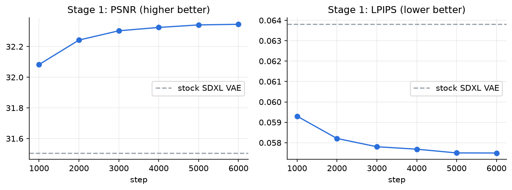
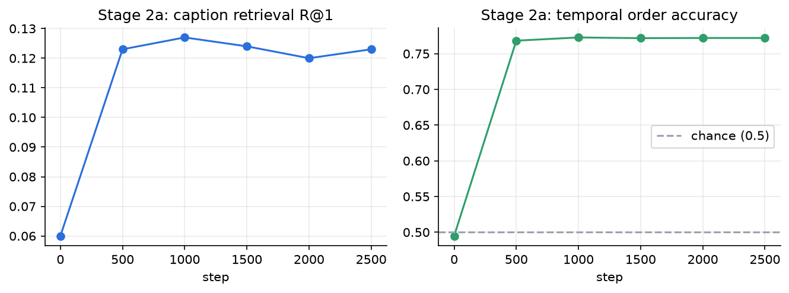
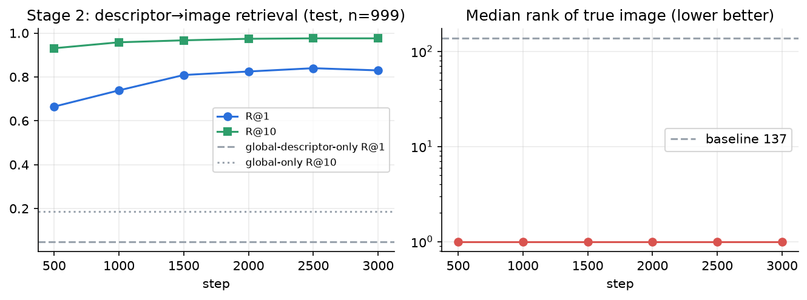
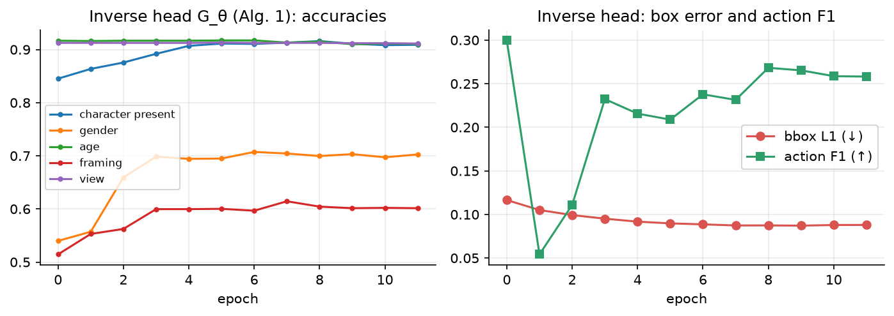

# Results

All numbers come from logged runs. The raw values are in `report/data/*.json`, and the figures are regenerated by
`report/make_figs_1.py`. Everything is reported, including failures.

## Summary

| Stage | Metric | Before | After |
|---|---|---|---|
| 1 · anime VAE decoder | PSNR / LPIPS on held-out anime crops | 31.51 dB / 0.0638 | **32.35 dB / 0.0575** |
| 2a · action-text pre-training | sub-action **order accuracy** (temporal module) | 49.5% (chance) | **77.2%** |
| 2a · action-text pre-training | caption retrieval R@1 (1,000 motions) | 6.0% | **12.3%** |
| 2 · LAM on anime triplets | descriptor → image retrieval R@1 / R@10 (999 test) | 4.9% / 18.6% | **83.0% / 97.6%** |
| Algorithm 1 head `G_θ` | presence / gender / box L1 / action F1 | — | 90.9% / 70.3% / 0.088 / 0.258 |
| 3–5 · full U-Net (11k steps) | hair-colour leak / eye-colour leak (lower is better) | 0.125 / 0.375 | **0.05 / 0.10** |
| 3–5 · full U-Net (11k steps) | 8×8 colour factorial: hair / eye correct, vs stock Animagine | 100% / 48.4% (stock) | 64.8% / 56.2% |

## Attribute control after full training

Held-out test specs. Rows: ground truth · as specified · **only** the eye colour changed to red · **only** the
hair colour changed to blonde · action stream off.

Changing one attribute mostly changes only that attribute. With the action stream off, the characters revert to
generic Animagine output. That shows the descriptor, not the global text, is driving the characters.
Multi-action specs: [`reports/final/final_diag_multi.jpg`](../reports/final/final_diag_multi.jpg).

### Colour leakage

`lam/tests/eval_leakage.py` takes 40 single-character test specs with a recognisable hair and eye colour. It
renders each one as specified, with only the eye colour swapped, and with only the hair colour swapped, then reads
the colours with a CLIP zero-shot classifier on the character crop. **Leak** = how much the *other* attribute's
accuracy drops when one is swapped.

| Model | hair leak | eye leak |
|---|---|---|
| Stock initialisation (stage-2 encoder, untrained U-Net) | 0.125 | 0.375 |
| LoRA pilot (~250 steps) | 0.025 | 0.175 |
| LoRA + swap-consistency loss (~150 steps) | 0.05 | 0.25 |
| **Final full U-Net (11,000 steps)** | **0.05** | **0.10** |

At n = 40, a difference of 0.025 is one image, so read these as trends.

## Training-stage curves

| Stage 1 | Stage 2a | Stage 2 | `G_θ` |
|---|---|---|---|
|  |  |  |  |

## Milestones and diagnosis (what went wrong, and how it was fixed)

### Overfit failure → v3 conditioning
The first 16-sample overfit produced no characters ([`reports/m3_overfit_v2/overfit_comparison.jpg`](../reports/m3_overfit_v2/overfit_comparison.jpg)).
Step-0 diagnosis ([`reports/m3_diag/`](../reports/m3_diag)) found three causes:
- an incompatible old encoder checkpoint (token norms 55–166 vs 34 for text);
- action attention *added* on top of text attention, which turned images muddy;
- a CFG-amplified shift of SDXL's pooled embedding.

The **v3** design (shared softmax, full attribute token sequences, no pooled shift) draws matching characters
before any training ([`diag_step0_v3.jpg`](../reports/m3_diag/diag_step0_v3.jpg)), and its overfit reproduced
the training specs ([`diag_ckpt_v3.jpg`](../reports/m3_diag/diag_ckpt_v3.jpg)). Details are in
[IMPLEMENTATION.md](IMPLEMENTATION.md#design-history-the-v3-conditioning).

### Pilots and the swirl fix
With the first loss weights (λ_action-img 0.05, λ_perc 0.1, λ_style 2000), every sample grid turned into swirly,
muddy texture by step 200. Diffusion-only and 10× lower auxiliary weights both stayed clean
([`reports/pilot/`](../reports/pilot)). The final run uses the lowered weights.

### Full-U-Net gate and run
[`reports/gate_full/`](../reports/gate_full) is the 16-sample overfit with every U-Net weight trained, against its
ground truth. [`reports/phaseB/`](../reports/phaseB) is the first sample grid of the full run.
[`reports/kaggle/`](../reports/kaggle) holds fp16 / bf16 precision checks of the trained model on Kaggle T4s.

## Colour factorial vs stock Animagine

Kaggle notebook `lam-eval` (2× T4): one character on a plain background, **8 hair colours × 8 eye colours ×
2 seeds**, 20 steps. It's rendered by the trained model (from the descriptor) and by stock Animagine XL
(prompt only, same seed). A CLIP zero-shot classifier reads hair and eye colour. Raw scores:
[`report/data/colour_factorial.json`](../report/data/colour_factorial.json).

| System | hair colour correct | eye colour correct | both correct |
|---|---|---|---|
| LAM-Diffusion (trained, 11k steps) | 64.8% | **56.2%** | 31.2% |
| Stock Animagine XL (prompt only) | **100%** | 48.4% | **48.4%** |

**This is a negative result for hair colour.** The trained model is slightly better on eye colour, but much worse
on hair. It collapses some requested colours to white or silver: red is correct 25% of the time, blue 6%, black
56%. Green, purple and pink are 75–81%, and blonde and white 100%. The leakage probe above measures something
different (whether changing one attribute moves the other), so the two results don't contradict each other. They
do mean the model doesn't yet beat its base on absolute colour accuracy. Likely causes:
- a bias toward silver/white hair in the training labels or the data;
- weakening of the base model's colour vocabulary during full-U-Net training;
- CLIP misreading stylised hair.

These have not been separated yet.

## Paper metrics (§V-C)

`lam/eval/generate.py` + `lam/eval/metrics.py` compute CLIP Score, FID / KID, LPIPS, SSIM, attribute-binding
precision/recall and pose PCK@0.1 for the prompt-only baseline, the §V-style ControlNet system, the trained
model and its ablations (no region masks, no temporal stream, action stream off). That full suite hasn't been run
on the final weights yet.

The paper's headline numbers (CLIP 0.87, FID 18.4, LPIPS 0.32, SSIM 0.91, binding 0.94) came from its
inference-only §V setup and **are not reproduced or compared here**.

## The app's ControlNet engine (paper §V style)

[`output/samples/all_samples.png`](../output/samples/all_samples.png): eight prompts, each showing the planned
pose, the planner + pose + ControlNet result, and the prompt-only baseline on the same seed.

- **Pose following works:** two girls jumping on a beach, a girl with silver hair waving, an elderly man on a bench, three girls dancing.
- **Failures of the rule/LLM planner + ControlNet pipeline:**
  - a couple walking in a park becomes four people seen from behind;
  - the classroom boy and girl become two girls in a default hands-on-hips pose;
  - the knight with a sword becomes a close-up with the sword barely visible;
  - the girl reading under a cherry tree has the book covering her face.

These failures are why the paper moves to a learned §IV model.

## Known limitations

- **Pose following and character counts are partial.** Cross-attention-only pose conditioning (the paper's design) is weaker than ControlNet.
- **Hair-colour accuracy is below the base model** (64.8% vs 100% for stock Animagine). Red and blue hair often come out white or silver.
- **Some eye → hair colour leakage remains** (0.10 eye leak).
- **Identical-looking characters** in multi-character scenes.
- **Noisy labels:** the descriptors come from a tagger and a pose detector, and are noisiest in multi-character images.
- **Temporal attention is trained on ordered text actions**, but still anime images give it little to act on.
- **Not run yet:** the fine-tuned planner LoRA wasn't part of the final weights upload; the app falls back to the base LLM or rule planner.
