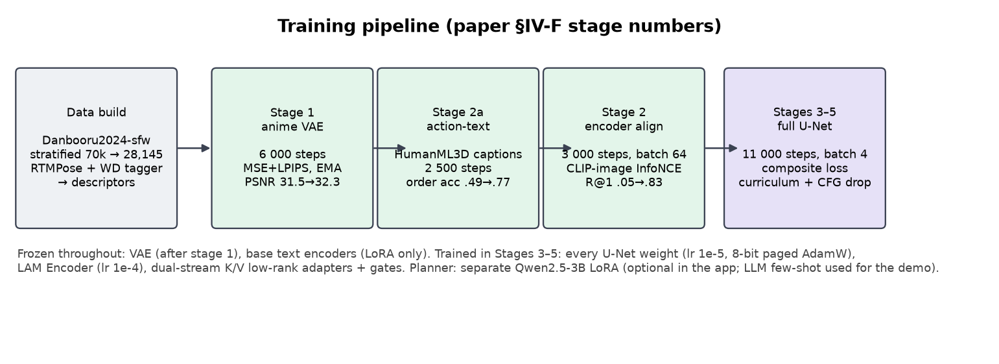
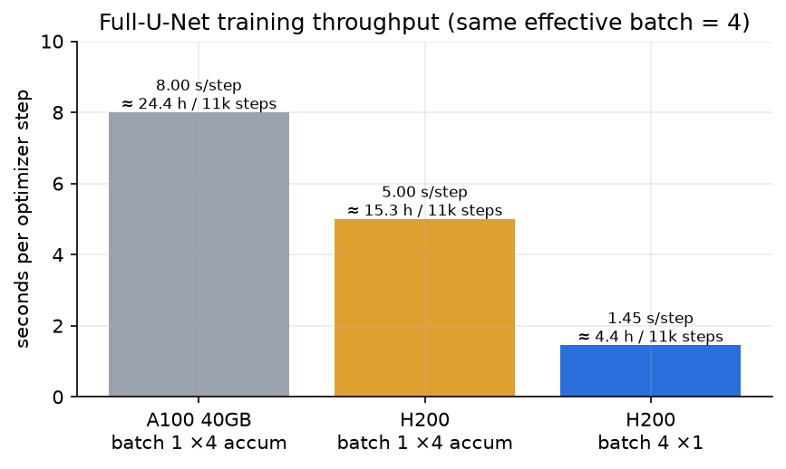

# Training workflow

All training runs on a single cloud GPU. The repo's scripts drive Google Colab through the
`colab` command-line tool (`google-colab-cli`); the final full-U-Net run used an H200. Paths default to
the Colab layout (`/content/data`, `/content/ckpt`), and every script takes flags to change them.



## 0. Environment

```bash
python scripts/vm_setup.py   # on the GPU box: diffusers, transformers, peft, accelerate, bitsandbytes, lpips, clean-fid, rtmlib, ...
```

Base models are downloaded from Hugging Face on first use:
- `cagliostrolab/animagine-xl-4.0` (U-Net, text encoders, scheduler)
- `madebyollin/sdxl-vae-fp16-fix` and `madebyollin/taesdxl`
- `openai/clip-vit-large-patch14`
- `Qwen/Qwen2.5-3B-Instruct` (planner)

## 1. Build the dataset

```bash
python -m lam.data.select        # balanced post IDs from metadata
python -m lam.data.fetch         # range-request downloads
python -m lam.data.annotate      # poses + per-character attributes  (GPU)
python -m lam.data.precompute    # latents, CLIP embeddings, split   (GPU)
python -m lam.pose_library       # k-means skeletons per action
```

See [DATASET.md](DATASET.md). `lam/jobs/prep_data.sh` chains these from a saved annotation bundle.

## 2. Stages

### Stage 1: anime VAE (`lam/train_vae.py`)
Decoder-only fine-tune of the SDXL VAE on random 512² crops of the anime images (resized to SDXL scale). It uses
MSE + 0.1·LPIPS with EMA weights, the recipe of Stability's sd-vae-ft-mse. The encoder stays frozen, so latents
don't move. **Gate:** it must beat the stock decoder on held-out anime crops.

```bash
python -m lam.train_vae --out /content/ckpt/vae_anime     # 6,000 steps, batch 4 on a 24 GB L4
```


| | PSNR ↑ | LPIPS ↓ |
|---|---|---|
| Stock SDXL VAE | 31.51 dB | 0.0638 |
| Anime decoder (6k steps, EMA) | **32.35 dB** | **0.0575** |

### Stage 2a: action-text pre-training
Script: `lam/train_stage2a.py`. Corpus: HumanML3D captions. Four objectives:

- `L_cap`: two captions of the same motion are positives, which teaches the backbone action semantics.
- `L_seq`: the temporal context of the ordered sub-action sequence must retrieve its caption.
- `L_order`: true vs shuffled sub-action order, read from the temporal context. This trains the Temporal Attention Module on genuinely ordered actions.
- `L_keep`: keeps the backbone's hidden states near the frozen ones, so the U-Net's text stream doesn't drift.

```bash
python -m lam.train_stage2a --out /content/ckpt/stage2a.pt     # 2,500 steps, batch 128
```


| | caption R@1 (1,000 motions) | sub-action order accuracy |
|---|---|---|
| Before | 6.0% | 49.5% (chance) |
| After 2a | **12.3%** | **77.2%** |

### Stage 2: LAM fine-tune on anime triplets (`lam/train_stage2.py`)
Contrastive alignment between the LAM action embedding (descriptor → CLIP image space) and the CLIP embedding of
the triplet's image, starting from stage 2a.

```bash
python -m lam.train_stage2 --init /content/ckpt/stage2a.pt --out /content/ckpt/stage2_from2a.pt --steps 3000
```


Descriptor → image retrieval on the 999 held-out triplets:

| | R@1 | R@10 | median rank |
|---|---|---|---|
| Global descriptor only (no characters) | 4.9% | 18.6% | 137 |
| Stage 2 (3k steps) | **83.0%** (best 84.0%) | **97.6%** | **1** |

### Stages 3–5: joint training (`lam/train_joint.py`)
- **Stage 3:** every U-Net weight trains (`--unet-mode full`), jointly with the LAM Encoder, with the VAE frozen. The loss is Eq. 3 with plain `L_diff` (`--min-snr 0`).
- **Stage 4:** progressive curriculum. The eligible pool grows from the simplest 40% of samples (fewest characters, actions and attributes) to 80%, then everything, over 30 / 40 / 30% of steps.
- **Stage 5:** CFG dropout. All conditioning is dropped 10% of the time, and each field independently 10% of the time.

Optimiser: paged 8-bit AdamW; U-Net LR 1e-5 (no weight decay); new modules 1e-4; text-encoder LoRA 2e-5; gates
1e-3; warm-up + cosine; gradient clipping 1.0; gradient checkpointing; bf16 autocast.

```bash
# 16-sample overfit gate first (must reproduce its training samples)
bash lam/jobs/a100_full.sh overfit
# then the full run (resumable; checkpoints every 30 min)
LAM_TOTAL_STEPS=11000 bash lam/jobs/phase_b.sh
```

**Final run:** 11,000 optimizer steps, effective batch 4, on a single H200 (about 1.45 s/step, about 4.4 h).



### Algorithm 1 head `G_θ` (`lam/train_inverse.py`)
ConvNet + transformer on precomputed VAE latents → descriptor (presence, gender, age, framing, view, actions,
box, keypoints, tag sets per field). 12 epochs, about 15 minutes on an L4.


| present | gender | framing | box L1 | action F1 |
|---|---|---|---|---|
| 90.9% | 70.3% | 60.1% | 0.088 | 0.258 |

(Age and view sit at about 91%, which is the majority class.)

### Planner (`lam/planner_ft.py`)
Qwen2.5-3B-Instruct + LoRA on (request → descriptor) pairs from `planner_data.py`.

## 3. Orchestration (`lam/jobs/`, `scripts/`)

| Script | Purpose |
|---|---|
| `scripts/colab_session.sh`, `vm_setup.py` | Create a Colab GPU session and install dependencies |
| `scripts/colab_job.sh start NAME cmd…` | Sync code and run a job in the background on the VM (`log`, `status`, `pull`) |
| `scripts/colab_keepalive.sh` | Colab reclaims a VM about 20 min after the last *cell execution*, even if a job is running. This pings it every 3 min. |
| `scripts/colab_upload_big.sh` | Split, upload and verify large files (the upload endpoint rejects big files) |
| `scripts/drive_mount.py` | Mount Google Drive on a CLI session without the Enter-key race |
| `lam/jobs/drive_data.sh` | Save / restore the dataset and checkpoints to Google Drive, so any VM resumes in minutes |
| `lam/jobs/phase_a.sh` | Stage 1 → 2a → 2, each saved to Drive; reruns skip finished stages |
| `lam/jobs/phase_b.sh` | Full-U-Net overfit gate, then the full run with Drive backup every 30 min and auto-resume |
| `lam/jobs/a100_full.sh` | Overfit gate / one resumable chunk of the full run |

## 4. Checks along the way (`lam/tests/`)

| Script | What it checks |
|---|---|
| `smoke.py` | Shapes; action stream off = exactly the base model; region masks match boxes at every resolution; Eq. 3 losses finite with gradients in the right places |
| `smoke_full.py` | A full-U-Net Eq. 3 training step at 1024 px (memory, speed), the save/reload round trip, Algorithm 1 sampling, the stage 2a pieces |
| `diag_step0.py` | Untrained or trained renders of fixed specs (the diagnosis that led to v3) |
| `diag_phase_a.py` | Held-out renders: as specified / eye swapped / hair swapped / action off |
| `eval_leakage.py` | Quantitative colour leakage (CLIP zero-shot on character crops) |
| `test_swap.py` | CPU unit tests for the attribute-swap pieces |
