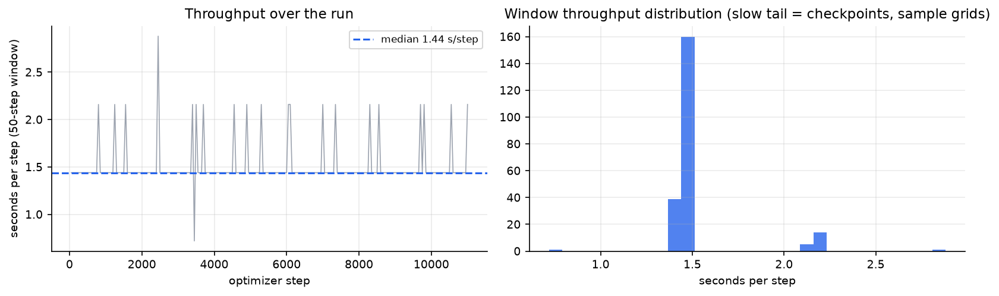
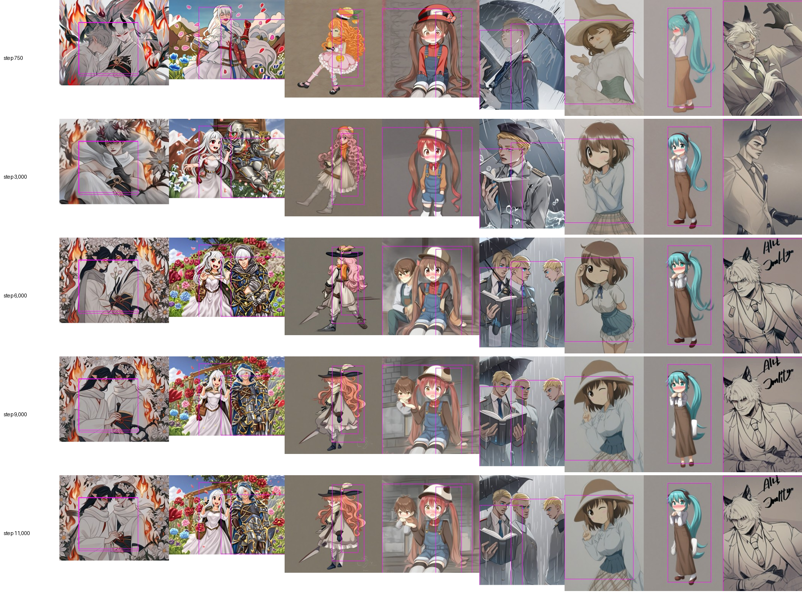

# Training-dynamics analysis (full 11,000-step run)

Statistics computed from the training log pulled from the Lightning studio
([`reports/data/full_run_phaseB.csv`](../reports/data/full_run_phaseB.csv): 220 records, each the mean over a
50-step window). Regenerate with `python reports/scripts/make_training_analysis.py`; tables are in
`reports/analysis/training_*.csv`. Nothing here is estimated: every number is computed from the log.

## 1. Do the losses trend?

Linear slope per 1,000 steps with a 95% bootstrap interval (4,000 resamples of the records), Spearman rank
correlation with step and its permutation p-value (10,000 permutations), and the relative change implied by the
slope across the range.

| Metric | Range | Mean | Slope / 1,000 steps [95% CI] | Spearman ρ | p | Change over range | Reading |
|---|---|---|---|---|---|---|---|
| L_diff | all steps | 0.1078 | 0.000245 [-6.38e-05, 0.000553] | +0.10 | 0.1215 | +2.5% | no clear trend |
| L_diff | after step 1000 | 0.1079 | 0.000265 [-7.6e-05, 0.000605] | +0.11 | 0.1300 | +2.4% | no clear trend |
| L_action-img | all steps | 3.597 | -0.0362 [-0.0601, -0.00892] | -0.53 | 0.0000 | -11.0% | ↓ decreasing |
| L_action-img | after step 1000 | 3.623 | -0.0682 [-0.0792, -0.0571] | -0.67 | 0.0000 | -18.7% | ↓ decreasing |
| L_perc | all steps | 0.1071 | -0.00058 [-0.00098, -0.00019] | -0.17 | 0.0147 | -5.9% | ↓ decreasing |
| L_perc | after step 1000 | 0.1066 | -0.000495 [-0.000984, -2.13e-05] | -0.13 | 0.0609 | -4.6% | borderline (CI excludes 0, p > 0.05) |
| L_style | all steps | 1.749e-05 | -4.24e-07 [-6.39e-07, -2.25e-07] | -0.32 | 0.0000 | -26.6% | ↓ decreasing |
| L_style | after step 1000 | 1.697e-05 | -2.07e-07 [-3.9e-07, -3.54e-08] | -0.20 | 0.0050 | -12.1% | ↓ decreasing |
| CLIP similarity | all steps | 0.6301 | 0.00227 [-0.000407, 0.00532] | +0.03 | 0.6438 | +3.9% | no clear trend |
| CLIP similarity | after step 1000 | 0.6342 | 2.5e-05 [-0.00176, 0.00181] | -0.01 | 0.8935 | +0.0% | no clear trend |

**Reading**
- **`L_diff` does not trend** in either range. The slope's interval spans zero (p ≈ 0.12): the noise-prediction loss is flat for the whole run.
- **`L_action-img` decreases significantly after the first 1,000 steps** (about −19% over the remaining run), so the early rise reported in the log is followed by a steady fall.
- **`L_style` decreases** (−27% overall, −12% after step 1,000) and **`L_perc` decreases weakly** (−6%; borderline after step 1,000).
- **CLIP similarity is flat after step 1,000.** Its rise happens in the first ~600 steps.

## 2. By curriculum stage

The sampler widens the eligible pool from the easiest 40% to 80% to 100% of samples (§IV-F stage 4), so the
stage means are **not directly comparable**: later stages contain harder samples by design. Values are mean ± SD
across the records of the stage.

| Curriculum stage | Steps | Records | L_diff | L_action-img | L_perc | L_style | CLIP sim. |
|---|---|---|---|---|---|---|---|
| stage A: easiest 40% | 50-3300 | 66 | 0.1067 ± 0.0071 | 3.752 ± 0.66 | 0.109 ± 0.0095 | 1.94e-05 ± 5.4e-06 | 0.6202 ± 0.074 |
| stage B: easiest 80% | 3350-7700 | 88 | 0.1078 ± 0.0065 | 3.628 ± 0.21 | 0.1071 ± 0.01 | 1.69e-05 ± 3.7e-06 | 0.6354 ± 0.035 |
| stage C: all samples | 7750-11000 | 66 | 0.109 ± 0.0073 | 3.402 ± 0.21 | 0.1051 ± 0.0098 | 1.63e-05 ± 3.4e-06 | 0.6329 ± 0.039 |

`L_diff` rises slightly from stage A to C (0.107 → 0.109), as expected when harder samples are added. The three
auxiliary terms still fall, even though the pool grows.

## 3. Throughput and time

| Quantity | Value |
|---|---|
| Total wall-clock | 4.60 h |
| Overall | 1.505 s per step (batch 4) |
| Median 50-step window | 1.44 s per step |
| 95th percentile window | 2.16 s per step |
| Windows more than 15% slower than the median | 20 of 220 (checkpoints and sample grids) |
| Time lost in those windows | about 756 s (≈ 4.6% of the run) |

| Steps | s / step | minutes per 1,000 steps |
|---|---|---|
| 1-1000 | 1.48 | 24.6 |
| 1001-2000 | 1.51 | 25.2 |
| 2001-3000 | 1.51 | 25.2 |
| 3001-4000 | 1.51 | 25.2 |
| 4001-5000 | 1.51 | 25.2 |
| 5001-6000 | 1.48 | 24.6 |
| 6001-7000 | 1.55 | 25.8 |
| 7001-8000 | 1.48 | 24.6 |
| 8001-9000 | 1.51 | 25.2 |
| 9001-10000 | 1.51 | 25.2 |
| 10001-11000 | 1.51 | 25.2 |

Throughput is steady across the run (the curriculum doesn't change the cost per step), apart from the
checkpoint and sample-grid overheads. 

## 4. How the samples evolve

The training script renders the same 8 specs (fixed seeds, no quality tags) every 750 steps. Rows below: steps
750, 3,000, 6,000, 9,000, 11,000.

What can be seen:
- **Composition and layout are already settled at step 750** (character placement, scene, palette). That is expected from a strong pre-trained backbone, and it fits the flat `L_diff`.
- **Later steps mostly refine detail:** sharper linework, more distinct faces and clothing, clearer multi-character separation.
- **Some attributes change between checkpoints** (for example the hair colour of the third spec shifts from orange towards salmon-pink). The sheet alone doesn't show which version matches the descriptor, so this is a note about instability, not an accuracy result.
- These are the muted "training-grid" renders (no quality tags, no negative prompt), so absolute quality isn't representative of the evaluation renders.

## 5. Training stability

- **No NaN or Inf in any logged window** (all 220 records are finite).
- **A numerical failure was found and fixed before this run:** on PyTorch 2.11 with an H200, the cuDNN fused-attention backward returned non-finite gradients for noise levels t ≳ 500. The diagnosis ran on a single training sample and swept t over [50, 990], comparing gradient checkpointing on/off, math-only attention, and cuDNN-attention-off
  ([`reports/milestones/nan_diag/`](../reports/milestones/nan_diag)). The fix is `enable_cudnn_sdp(False)` in `lam/train_joint.py`. The scripts are kept; their printed outputs weren't saved, so the threshold comes from the session notes.
- **The gate bias** moved smoothly and saturated at about −0.109 (mean) and +0.117 (max) by step ~8,000, as the learning rate decayed, with no jumps.

## 6. What these data support

| Statement | Supported? |
|---|---|
| Training ran stably for 11,000 steps with no non-finite values | ✅ Yes |
| The auxiliary alignment / perceptual / style losses improved during the run | ✅ Yes (significant for `L_action-img` and `L_style`) |
| The diffusion (noise-prediction) loss improved | ❌ No: flat, no significant trend |
| The model reached a lower diffusion loss than the pre-trained base | **Unknown**: the base model's loss on this data was not logged |
| Loss values predict attribute-binding quality | ❌ Not shown. The colour test ([ANALYSIS.md](ANALYSIS.md)) shows the end result is worse than the base on hair colour while auxiliary losses fell. |

**Open hypotheses (not tested):**
1. `L_diff` is flat because the pre-trained backbone is already near its floor on this data and the conditioning's effect is on *which* sample is generated, not on average noise error.
2. `L_action-img`'s early rise is a property of the InfoNCE queue: negatives become as image-like as the positive.
3. The small gate bias means the added action tokens are weighted roughly like text tokens, which would limit how strongly they can override the pre-trained colour prior.

A direct test of 1 would be to log the **base** model's `L_diff` on the same batches; for 2, an ablation with a larger or no queue.
