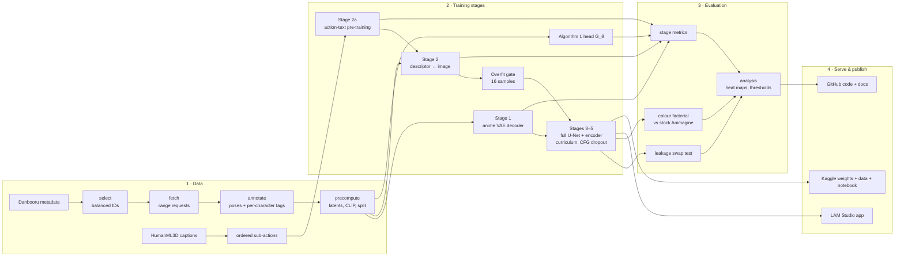
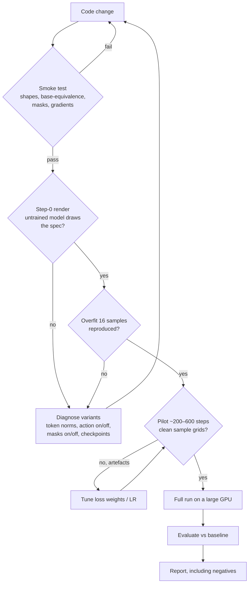
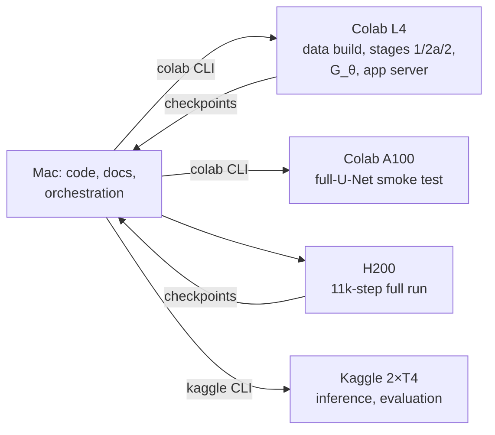
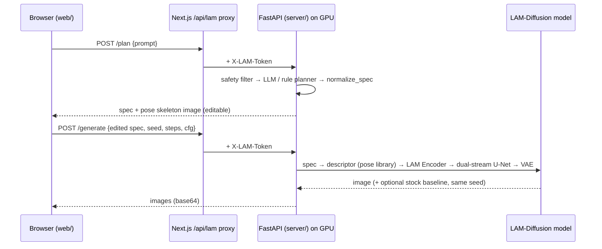

# Workflow

The end-to-end workflow of the project: data, training, validation, evaluation, serving and publishing. Each step
lists its inputs, outputs and the gate that must pass before moving on.

## 1. The whole pipeline

## 2. Step by step

| # | Step | Command | Input → output | Gate |
|---|---|---|---|---|
| 1 | Select | `python -m lam.data.select` | metadata → `selection.jsonl` (29,785 IDs) | Composition shares are as intended |
| 2 | Fetch | `python -m lam.data.fetch` | IDs → images | Most IDs fetched (resumable) |
| 3 | Annotate | `python -m lam.data.annotate` | images → `annotations.jsonl` | Visual QA grid looks right (`lam.data.report`) |
| 4 | Precompute | `python -m lam.data.precompute`, `python -m lam.pose_library` | → `samples/*.npz`, `index.jsonl` (27,146 / 999), `pose_library.json` | 28,145 kept after the size filter |
| 5 | Stage 1 | `python -m lam.train_vae` | images → `vae_anime/` | Beats the stock decoder on PSNR and LPIPS |
| 6 | Stage 2a | `python -m lam.train_stage2a` | HumanML3D → `stage2a.pt` | Order accuracy ≫ 50% |
| 7 | Stage 2 | `python -m lam.train_stage2 --init stage2a.pt` | triplets → `stage2_from2a.pt` | R@1 ≫ the global-only baseline |
| 8 | Overfit gate | `bash lam/jobs/a100_full.sh overfit` | 16 triplets → sample grids | Training specs reproduced, no artefacts |
| 9 | Full run | `LAM_GO=1 bash lam/jobs/phase_b.sh` | → `unet/`, `weights.pt` | Sample grids every 750 steps stay clean |
| 10 | G_θ | `python -m lam.train_inverse` | latents → `inverse.pt` | Above majority-class accuracy |
| 11 | Evaluate | `lam/tests/eval_leakage.py`, Kaggle `lam-eval`, `lam/eval/` | weights → JSON results | — |
| 12 | Analyse | `python reports/scripts/make_figs_1.py`, `make_analysis.py` | JSON → figures and tables | — |
| 13 | Serve | `scripts/colab_up.sh` or `uvicorn app:app` + `npm run dev` | weights → app | `/health` reports ready |
| 14 | Publish | `git push`; `kaggle datasets create/version`, `kaggle kernels push` | → GitHub, Kaggle | Links resolve; no secrets |

Shortcuts: steps 1–4 can be replaced by downloading
[`lam-diffusion-precomputed`](https://www.kaggle.com/datasets/shibilahamed0095/lam-diffusion-precomputed).
Steps 5–7 run in one go with `bash lam/jobs/paper_stages.sh`.

## 3. Development workflow (how a change gets accepted)

This ladder caught the failed first conditioning design at the overfit gate and diagnosed it at step 0, before
any long run. It also caught the swirl artefacts at the pilot stage.

## 4. Compute workflow

- **Background jobs:** `scripts/colab_job.sh start NAME cmd…` syncs the code and runs a detached job (`log`, `status`, `pull`).
- **Keep-alive:** Colab reclaims a VM about 20 min after the last cell execution, even mid-job, so `colab_keepalive.sh` pings it every 3 min. It runs on the Mac, so the Mac must stay awake.
- **Resumability:** every training script checkpoints periodically; `phase_a.sh` skips finished stages; `phase_b.sh` resumes from the newest checkpoint.
- **Large uploads:** `scripts/colab_upload_big.sh` splits files, uploads the pieces and verifies the checksum.

## 5. Serving workflow (one request in the app)

The proxy keeps the GPU server's address and token out of the browser. `LAM_ENGINE=lam` serves the trained model;
`controlnet` serves the earlier prototype.

## 6. Publishing workflow

| Artifact | Destination | Rule |
|---|---|---|
| Code, docs, figures, analysis, milestone sheets, demo video | GitHub | Nothing secret (`.env`, tokens), no weights, no data archives (`.gitignore`) |
| Trained U-Net + weights, anime VAE, stage checkpoints, G_θ | Kaggle datasets (`final`, `extras`) | Each large file exists once |
| Descriptors, precomputed training set | Kaggle datasets (`descriptors`, `precomputed`) | Source credited |
| Inference demo | Kaggle notebook (`lam-diffusion-inference`) | Clones the GitHub repo, so it always runs the current code |

Before each push: compile all Python, `bash -n` every script, type-check the web app, check every doc link,
and scan for secrets. See [ARTIFACTS.md](ARTIFACTS.md) for the full map.
